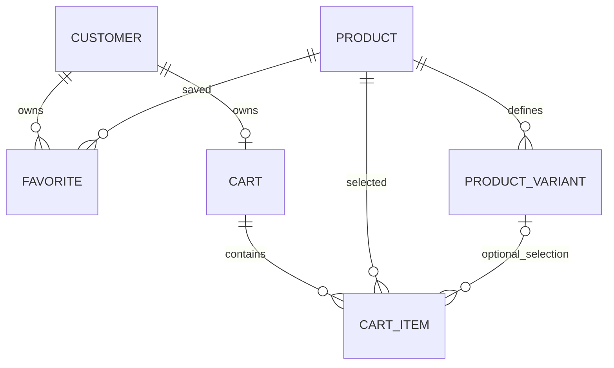

# Phase 04 - Favorites and Cart Design Gate

Date: 2026-10-11 (Asia/Damascus).
Status: **APPROVED through the owner's phase4.1.md authorization**.
D1 F1+H2, D2 U1+A1, D3 CART-C2, D4 M1+R1, D5 L1+O1 and D6 Q1 are accepted; Checkpoints C1-C3 and D are authorized. [ADR-017](../adr/ADR-017-approved-favorites-cart-foundation.md) records the decisions. Implementation and actual final verification are tracked in the [Phase 4 report](phase-04-favorites-cart-foundation-report.md).

The original analysis below is preserved as a **historical pre-approval record**. Its pending/NOT IMPLEMENTED labels, initial branch state, recommendations and draft responses describe the earlier checkpoint, not the present approved implementation. No accepted decision is reopened. The implementation report and API/schema documentation are authoritative for current execution evidence and final response shapes.

Source authorization: C:/Users/nabil/Desktop/sumaiya/phase4.1.md. Original engineering contract: C:/Users/nabil/Desktop/sumaiya/phase4.md.

## Historical pre-approval technical analysis

## Verified starting state

- Initial working tree clean; current branch `feature/catalog-foundation`.
- HEAD: `372d8e13af5f166bac5d771dd6f4fad17e840e42`.
- Local main: `8d9e355c09bfe531ab09bd45cfc8f1fb4ed9927e`; four commits behind origin/main.
- origin/main and live GitHub main: `95fb9d7df09c933d8fcdfb9d05db636894f3e565`.
- [PR #1](https://github.com/NabilAlsaidaly/Pharma/pull/1) verified merged at
  2026-10-10T20:00:13Z. HEAD and origin/main have identical tracked file contents;
  their history differs by the merge commit. No owner changes were overwritten.
- Origin remains `https://github.com/NabilAlsaidaly/Pharma.git`.
- `feature/favorites-cart-foundation` does not exist locally. Do not create it until
  approval; then base it on verified current origin/main and preserve this gate work.
- Laravel 13.35.0; PHP 8.4.26; Composer 2.10.2. Locked Sanctum 4.3.3,
  Socialite 5.31.0, Larastan 3.13.0, Pint 1.32.1, PHPUnit 12.5.38.
- Current runtime: local, APP_DEBUG off, MySQL, file session/cache, sync queue;
  Secure/HttpOnly session cookies and SameSite=Lax. Owner's temporary HTTPS Expose
  APP_URL remains unchanged; it is not a production target. Public storage not linked.
- Existing Favorites/Cart directories contain only four-layer scaffold markers.
  No applicable workspace/ancestor AGENTS.md was found.

### Inspection inventory and source precedence

Inspected README, composer.json/lock, bootstrap/app.php/providers.php, routes/api.php,
auth/Sanctum/CORS/database configuration, phpunit.xml, phpstan.neon and existing CI.
Reviewed module boundaries, coding/performance principles, Identity and Catalog
architecture, Catalog/Checkout and PAY-001 documents, existing API/schema contracts,
accepted ADRs 001-016, and Phase 0-3 reports (including the historical Phase 3 gate).
Inspected Customer/session/suspension code, provider bindings, installed Sanctum guard,
Product/Variant/Brand models, Catalog price/availability rules, public queries/resources
and IdentityTestCase/CatalogTestCase database safeguards.

Unlike earlier repository-only inspections, source SRS documents are now accessible
beside the phase file:

- `Sumaya_Pharma_SRS_v2_Arabic_Professional.docx`: sections 025 and 041-046.
- `Sumaya_Pharma_SRS_v2.0_Arabic.docx`: corresponding FR-CRT-041 through FR-CRT-046,
  AT-041 through AT-046, plus the interrupted-login requirement.
- A PDF also exists in that directory; it was located, not independently reviewed.

Read relevant paragraph/table text from both DOCX XML packages. python-docx was not
installed; native ZIP/XML extraction succeeded after correcting console UTF-8 output.
No Word layout review or document editing is claimed. Both texts establish backend
customer ownership, product-level Favorites, unique pairs, persistent Cart, quantity
and Variant changes, current-price validation, estimated totals, and repeated-add
quantity increment. They do not resolve the policy choices below. Historical Order
creation sequencing is superseded by accepted PAY-001; no original SRS was rewritten.

### Fresh baseline verification

| Check | Actual result |
| --- | --- |
| php --version / artisan --version | PHP 8.4.26 / Laravel 13.35.0 |
| composer --version | 2.10.2 |
| artisan about --no-ansi | Runtime inspected; no configuration changes |
| composer validate --strict | Valid |
| composer check-platform-reqs | All requirements passed |
| composer audit | No security vulnerability advisories |
| php vendor/bin/pint --test | Passed |
| php vendor/bin/phpstan analyse --no-progress | No errors |
| php artisan test --compact | **76 passed, 621 assertions**; actual duration 76.83s |
| php artisan migrate:status | Only customers batch 1 and Catalog batch 2; both Ran |
| php artisan route:list --no-ansi | Existing 17 routes, eight public Catalog reads; no Favorites/Cart routes |
| git diff HEAD origin/main --stat | Empty; tracked contents identical |
| GitHub main CI | [38082008896](https://github.com/NabilAlsaidaly/Pharma/actions/runs/38082008896), exact main SHA above, completed/success |

Initial sandbox runtime inspection reported inability to write PHP's configured
external temporary directory. Approved rerun succeeded; no global PHP configuration
was changed. Existing tests use isolated `sumaya_pharma_test`, not development.
Identity's 28 existing tests and all Catalog tests passed unchanged. This is baseline
verification, not evidence that proposed Phase 4 constraints/concurrency already work.
No new CI run, Phase 4 tests or live Google consent flow is claimed at this gate.

### Read-only development database evidence

Connection name verified before reading: `sumaya_pharma`, MySQL **9.7.0**.
Eight existing tables: customers, migrations and the six Catalog tables.
Customer count: **1**; migrations: **2**; each Catalog table: **0**.
Customer schema still has the nine Identity columns; no Favorites/Cart/Order/Payment
or reservation tables exist. No pending business migration was found.

Full customer-row SHA-256, all columns/rows sorted by id:
`bfd1fec4fa98a4844988f217c4a4a887a41861e2f5559397fea314cf8184ab6c`.
It matches Phase 3 evidence. Each empty Catalog table's row-array hash:
`4f53cda18c2baa0c0354bb5f9a3ecbe5ed12ab4d8e11ba873c2f11161202b945`.
No credentials, personal field values or customer identifiers are disclosed.
Post-gate read-only comparison also passed: customer count/hash identical, all six
Catalog counts still zero. Actual transaction isolation is REPEATABLE-READ. No
migration/reset/seed/write was run on development. Automated test refreshes target
only the guarded test database.

## Decision classification

| Subject | Classification | Source / resolution |
| --- | --- | --- |
| Customer-authenticated backend persistence and isolation | APPROVED | phase4 sections 1, 6, 10, 13, 27-28; ADR-011/014; accessible SRS |
| Product-level Favorites, unique customer/product relation | APPROVED | SRS 041-042; phase4 10-11 |
| Explicit Variant ownership, no artificial default selection | APPROVED | ADR-016/P1; phase4 15 |
| Intentional repeated additions increase quantity | APPROVED | SRS 046; phase4 16 |
| Positive integer quantities; separate removal | APPROVED | phase4 17 |
| Current independent USD/SYP decimal prices, no conversion/inheritance | APPROVED | ADR-016/P1/C2; phase4 20-24 |
| V1 precedence and hidden product/brand privacy | APPROVED | ADR-016/V1/S1; phase4 9 |
| PAY-001; no reservation/payment/order effects | APPROVED | ADR-015; phase4 8 |
| Existing session auth, suspension, CSRF and response envelopes | APPROVED | ADR-014 and current implementation |
| Favorite/cart visibility retention policies | BUSINESS CLARIFICATION REQUIRED | Decision D1: F1 + H2 recommended |
| Unpriced/zero, on_request and unavailable Cart policy | BUSINESS CLARIFICATION REQUIRED | Decision D2: U1 + A1 recommended |
| Cart currency and incomplete totals | BUSINESS CLARIFICATION REQUIRED | Decision D3: CART-C2 recommended |
| Variant collision and browser-retry semantics | BUSINESS CLARIFICATION REQUIRED | Decision D4: M1 + R1 recommended |
| One persistent Cart, schema and Catalog composite FK index | ARCHITECTURAL DECISION REQUIRED | Decision D5: L1 + O1 recommended; explicit Catalog schema authorization needed |
| Resource ceilings vs commercial quantity limit | ARCHITECTURAL DECISION REQUIRED | Decision D6: Q1 proposed technical bounds; no commercial maximum approved |
| Generated-key uniqueness, short transactions, eager loading | TECHNICAL IMPLEMENTATION CHOICE | Conditional on approved schema; real 8.4/9.7 proof still required |
| Pagination, input whitelist and per-customer throttle | TECHNICAL IMPLEMENTATION CHOICE | Explicit draft below, open for operational review |
| Checkout/payment/inventory/admin/frontend/System Console | DEFERRED | Strict exclusions; no implementation now |

## Owner approval package

Six grouped decisions cover the unresolved questions. Each alternative is a proposal.
Approving a bundle also approves its explicit draft API semantics, not future Checkout.

### D1 - Retention and private visibility: recommend F1 + H2

**Question:** How should existing saved relations/items appear after product or brand hiding?

| Option | Behavior and advantages | Disadvantages / customer impact |
| --- | --- | --- |
| F1 (recommended) | Keep Favorite row; exclude hidden products from list and list count; membership lookup for hidden/unknown product uniformly 404. Reactivation restores list entry. No private details or hidden-count oracle. | Customer cannot see why an entry temporarily disappeared. |
| F2 | Keep relation; show minimal unavailable Favorite placeholder, no product details. | Makes retention visible; requires a safe opaque Favorite identity or response convention, despite product-level relation. |
| H1 | Keep CartItem but omit hidden items from output. | Quiet omission makes quantities/totals hard to explain; must still mark whole-cart total incomplete. |
| H2 (recommended) | Keep CartItem; show only its owned item id, quantity and generic inaccessible status, with product=null and variant=null. Customer can remove it. Reactivation restores current details. | Explicit placeholder needs client handling; shows the customer's own retained item count, not hidden Catalog data. |

Database: retain rows; no GET cleanup, soft deletes or copied names/prices.
API: Favorite pagination counts only visible entries. Idempotent Favorite DELETE
uses the known product UUID and current customer's relation, regardless of current
Catalog visibility, returning the same success if already absent. Cart placeholders
omit product/variant IDs, name, slug, image, brand, prices and declared availability.
Generic reason `selection_inaccessible` must not distinguish missing/hidden product
from hidden brand. Hidden-item quantity reduction/removal permitted; increases and
Variant changes rejected uniformly with 409, without exposing Catalog fields.
Future Checkout: hidden/invalid selections block complete validation; retention never
grants eligibility. Product unavailability/pricing changes do not remove Favorites;
visible Favorite summaries keep current informational Catalog semantics.

### D2 - Price and availability admission: recommend U1 + A1

**Question:** Which current selections can be newly added/increased/changed, and what
happens when a retained selection loses its price or availability?

| Option | Advantages | Disadvantages / business implications |
| --- | --- | --- |
| U1 (recommended) | Reject additions/increases/Variant targets unless at least one supported currency has a configured price >0; retain existing selections if prices later vanish/zero. Favorites still allow visible informational products. | Cannot use Cart to collect initially unpriced inquiries. Losing prices requires client warning, not silent removal. |
| U2 | Permit unpriced/zero selections as explicit blocked intentions; never value missing price as zero. | More non-actionable Cart entries and incomplete totals; greater risk of clients treating information as purchase authorization. |
| A1 (recommended) | available and on_request can enter Cart when U1 permits. on_request explicitly requires a request and is not immediately actionable. Block new unavailable selections/increases/targets; retain existing unavailable rows for reduction/removal. | on_request remains an intention only; the actual inquiry and future payment eligibility process is deferred. |
| A2 | Admit only available selections; retain rows that later become on_request/unavailable, flagged. | Simpler actionable-cart expectation, but customers cannot collect request-only selections in Cart. |

Database: no priced/availability snapshot or eligibility column in Cart; changes are
evaluated from Catalog. API: known visible but inadmissible selection returns 409
RESOURCE_CONFLICT with a safe documented reason; malformed/missing-required/foreign
Variant selection returns 422. Null and zero each remain distinguishable current
price values; neither passes positive-price validation. Retained missing/zero prices,
unavailable states and stale Variant structure are reported explicitly on GET.
Reduction/removal of retained blocked items is allowed. No automatic quotation,
inquiry, payment, stock or eligibility-to-buy workflow is introduced.
Future Checkout: must choose an actual positive-price currency and independently
resolve request-only availability; A1 does not authorize direct Checkout for on_request.

### D3 - Currency and totals: recommend CART-C2

**Question:** Does Cart store one currency, show two independent estimates, or use per-item currency?

| Option | Advantages | Disadvantages / DB, API and Checkout implications |
| --- | --- | --- |
| CART-C1 | One explicit customer-selected Cart currency gives one clear estimate. | Needs currency persistence/change policy and API operation; no default may be invented; selections missing that currency need rejection/blocked policy. Checkout consumes that choice. |
| CART-C2 (recommended) | No currency column/default. Independently evaluate USD and SYP from the exact selection; customer can see which currency covers all items. Smallest schema, no conversion. | Two estimates require completeness explanations. Checkout later explicitly chooses currency and revalidates every line. |
| CART-C3 | Per-item explicit currency and separate totals allow mixed intentions. | Extra item currency field, mutation semantics and future multi-currency settlement decisions; more customer complexity. |

Under CART-C2, each currency returns: `priced_subtotal` (positive, valid, visible
selections), `estimated_total` (same subtotal only when complete, else null),
`complete`, and excluded item counts/reason breakdown. Missing/zero prices,
inaccessible/structurally invalid selections and effective unavailable selections
make that currency incomplete. on_request lines with positive prices contribute
to the estimate but also to `requires_request_count`, never a buying guarantee.
Empty Cart: both estimates "0.00", complete=true and item_count=0; explicitly empty,
not a free purchase. All estimates cover the whole Cart, not just the displayed page.
Never combine USD and SYP, use variant ranges, or disguise partial subtotal as total.
Current prices are shown at every read/mutation; no historical snapshot is stored.
Consequently there is no server-side previous-price delta promise: client may compare
previous display with new `evaluated_at` values; a future binding quote is deferred.

### D4 - Variant collisions, edits and retry: recommend M1 + R1

**Question:** What happens when a Variant change targets an existing selection and
when the same add request is retried rather than intentionally repeated?

| Option | Advantages | Disadvantages / implications |
| --- | --- | --- |
| M1 (recommended) | Preserve source quantity on change; merge by adding source and destination quantities if collision, delete source atomically, return surviving destination id. Reevaluate target's exact current price/availability. | Client must replace source identity after merge; overflow/resource failure rolls back both rows. |
| M2 | Preserve quantity but reject existing-destination collision with 409. | Simpler row identity; customer must manually combine/remove items, unlike normal repeated-add convenience. |
| R1 (recommended minimal policy) | Every accepted POST add increments; no retry key/table. Intentional repeated requests remain distinct. PATCH sets absolute quantity and requires Cart expected_version, preventing stale overwrites. | A retry/double click of POST can increment again; client must not automatically replay uncertain POST. It reads Cart to recover and asks before another increment. Not exactly-once processing. |
| R2 | Explicit per-customer Idempotency-Key deduplicates the same logical POST; different keys increment. | Requires additional persistence, atomic result/payload fingerprint, retention window, bounded key count and cleanup design approval; longer schema and tests. Lost keys still allow duplicate intent. |

No universal idempotency framework is recommended. R2 would require a separate
exact schema/retention proposal before code; no implicit 24-hour policy is accepted.
Under R1: disable duplicate click while in flight; after unknown response, GET current
Cart before user-confirmed retry. PATCH permits exactly one of quantity or variant_id,
plus expected_version; combining quantity and Variant edits in one PATCH is 422.
Variant PATCH to same Variant is a no-op; quantity PATCH to same value is a no-op.
Both still check scope/version. Invalid/removed target is rejected, preserving source.
Successful changes increment Cart version; stale expected_version returns 409.
Replay of an already successful PATCH may return stale-version 409, never apply twice.
DELETE is idempotent for own/missing/stolen item UUID (same 200; never changes another
customer's row). Add does not require expected_version: increments are serialized.
Future Checkout gets current surviving selection/quantity, not an Order snapshot.

### D5 - Schema and ownership: recommend L1 + O1

**Question:** Approve one persistent Cart per customer and the smallest Catalog
index addition needed for database-enforced Product/Variant ownership?

| Option | Advantages | Disadvantages / implications |
| --- | --- | --- |
| L1 (recommended) | carts UUIDv7 + UNIQUE(customer_id), created lazily on first successful add; cart_items UUIDv7. Product-level Favorites composite PK without redundant UUID. Mirrors SRS Customer -> Cart -> Items. | Cart joins needed; current main must be synchronized before approved feature work. |
| L2 | Flat customer-owned cart_items without Cart entity. | Smaller table count, but Cart version/serialization needs Customer coupling; departs from supplied conceptual design and does not provide a clear Cart aggregate. |
| O1 (recommended; explicit authorization required) | Add UNIQUE(id,product_id) to product_variants; cart_items composite FK (variant_id,product_id) references it. Rejects cross-product pairing and referenced Variant reparenting even if normal validation is bypassed. | One additional Catalog index has write/storage cost; redundant for id uniqueness, necessary as exact composite FK target. Changes schema, not pricing/visibility rules or Catalog data. |
| O2 | Keep Catalog schema unchanged, use simple Variant FK plus application parent check/locks. | Does not enforce pairing against raw SQL/bulk bypass; would need approved triggers on Cart and Catalog update paths for equivalent protection. More complex locking/migration privileges and audit burden; not recommended. |

Existing actual product_variants indexes: PRIMARY(id) and nonunique
(product_id,sort_order,id); no exact composite unique target exists. This is not
a Catalog defect: Phase 3 had no Cart relationship requiring it. MySQL 8.4's
standard referenced-key rules motivate O1; do not change server settings to enable
deprecated nonstandard referenced keys. See the [official FK manual](https://dev.mysql.com/doc/refman/8.4/en/create-table-foreign-keys.html).
No Catalog schema modification has been performed. Approval of O1 explicitly
authorizes only this additive index, to be safely forward-migrated and preflighted.
Catalog's existing price ownership locks remain unchanged.

### D6 - Technical safety bounds: propose Q1

**Question:** Approve input/resource ceilings without inventing a commercial purchase maximum?

| Option | Advantages | Disadvantages / implications |
| --- | --- | --- |
| Q1 (recommended technical baseline) | quantity signed INT, 1..2,147,483,647; at most 200 distinct Cart selections; 16 KiB mutation body; paginated reads default 12 / max 48; configurable customer mutation throttle 60/min and reads 120/min. | Distinct-item ceiling affects UX and needs explicit operational review; integer bound is a representation limit, not permission to buy huge quantities. No production capacity proof. |
| Q2 | Owner supplies lower commercial per-item/per-Cart limits and/or different operational ceilings. | Must state exact bounds and whether overflow rejects or requires action; cannot implement guessed limits. |

Propose rejection with rollback for stored-quantity overflow and merge/add overflow;
never clamp, wrap, remove or silently reduce quantities. Technical selection ceiling
checked under Cart lock; adding quantity to an existing selection is not a new row.
No separate commercial maximum is set by Q1. Cart capacity 409, invalid quantity 422,
oversized body 413 (existing safe envelope must gain a documented status/code mapping
after approval), throttle 429 with Retry-After. File cache is the existing local
rate-limiter store; no new Redis cache/lock infrastructure. Per-customer keys use the
authenticated guard identity, not caller customer_id; no assumption that IP-only limits
cover authenticated abuse. Rate thresholds are proposed operational choices, not
production tuning evidence or distributed-file-cache guarantees.

## 1. Favorites schema proposal

**PLANNED, conditional on F1/L1.** favorites has customer_id and product_id char(36)
NOT NULL, PRIMARY(customer_id,product_id), created_at timestamp NOT NULL.
No Favorite UUID, quantity, prices, status or updated_at: saving is an immutable
relationship, repeated add is a no-op preserving created_at. Removal/re-add obtains
a new saved time. FKs to customers.id/products.id, delete/update RESTRICT.
No cascade cleanup of real customer or Catalog data. Future entity deletion workflows
must explicitly remove dependent personal relations; they are not implemented now.

## 2. Cart schema proposal

**PLANNED, conditional on L1/R1/CART-C2.** carts: id char(36) UUIDv7 PK,
customer_id char(36) NOT NULL UNIQUE FK customers.id RESTRICT,
version BIGINT UNSIGNED NOT NULL default 0, created_at/updated_at timestamps NOT NULL.
Version serializes as a decimal string to avoid JavaScript integer precision problems;
check overflow before increment. No currency, price snapshot, reservation or status.
GET for customer without Cart returns empty representation with id=null/version="0";
it does not create a Cart. First successful mutation creates the persistent Cart.

## 3. CartItem schema proposal

**PLANNED, conditional on O1/Q1.** cart_items: id char(36) UUIDv7 PK,
cart_id/product_id char(36) NOT NULL; variant_id char(36) NULL;
quantity INT NOT NULL, CHECK(quantity BETWEEN 1 AND 2147483647), no default quantity;
created_at/updated_at timestamp NOT NULL; generated selection_key char(36) STORED
as COALESCE(variant_id,''); UNIQUE(cart_id,product_id,selection_key).
FK cart_id -> carts.id; product_id -> products.id; composite
(variant_id,product_id) -> product_variants(id,product_id), all RESTRICT.
No stored unit price, total, currency, private master-data copy or reservation fields.
No active/deleted lifecycle: explicit removal deletes the personal CartItem.

## 4. Relationships and cardinality



No new authentication identity or reverse dependency from Catalog to Cart/Favorites.
Favorites/Cart models own their Customer/Product references; Identity's Customer
does not need cross-module relationship methods for ordinary scoped operations.

## 5. Unique constraints

favorites PK(customer_id,product_id), carts UNIQUE(customer_id), cart_items
UNIQUE(cart_id,product_id,selection_key); independent Cart/Item UUIDv7 primary keys.
O1 requires the additional Catalog UNIQUE(id,product_id) referenced key. No duplicate
identity added to Favorite and no firstOrCreate-only correctness claim.

## 6. Nullable Variant uniqueness

The generated internal empty string represents absent selection *only in the unique
index*, not a dummy Variant UUID/FK/API value. Actual variant_id remains NULL for a
simple product. COALESCE always yields a non-null key: duplicate null-Variant selections
collide, as do duplicate actual Variant selections. Product ID distinguishes simple
products. Clients cannot set selection_key.

Ordinary UNIQUE(cart_id,product_id,variant_id) permits duplicate NULL cases; this is
documented in the [MySQL unique-index manual](https://dev.mysql.com/doc/refman/8.4/en/create-index.html).
The proposed constraint is **NOT YET VERIFIED** on either target version; Phase 3's
image preflight is not proof of this different expression/composite design. After
approval, test actual insert/collision/update cases on local 9.7 and CI 8.4 before
development adoption. No pre-approval tables or schema probe were created.

## 7. Product/Variant ownership enforcement

Application validates visibility and parent ownership; Variant products require
explicit Variant, simple products reject supplied Variant. Composite FK independently
enforces the non-null pairing. Its NULL case is covered by the direct product FK.
Cross-table "product now has variants but retained item has none" cannot be expressed
as a simple CHECK: current evaluation marks structure invalid, preserving the old
item for removal or an approved explicit Variant selection. Future Catalog structure
management must observe these references/locks; do not bypass Catalog price saves.

## 8. Quantity handling

POST quantity is required positive JSON integer; numeric strings/fractions/exponents,
zero/negative/out-of-range inputs rejected. Repeated valid addition sums quantities
under lock after range validation. PATCH quantity is absolute, not a signed delta;
expected_version protects stale edits. Reduction on blocked retained items is allowed.
DELETE is separate. All overflow/merge failures roll back the full transaction.

## 9. Currency strategy

CART-C2 draft is the selected *recommendation*, not an approval. Neither Cart nor Item
stores currency. The two current currency evaluations never infer a missing price,
inherit from a variant parent or choose a default. CART-C1/C3 require revising this
schema/API before implementation if selected instead.

## 10. Estimated total calculation

Focused Cart evaluator uses exact selected Product/Variant amounts. Existing locked
brick/math 1.0.0 is available; inspect/use BigDecimal.of/plus/multipliedBy/toScale(2)
with no float/native cents conversion. No dependency installation proposed.
At Q1's limits, the theoretical currency sum is below 4.30 x 10^27; arbitrary-precision
decimal arithmetic avoids 64-bit cents overflow. Test max prices/quantities and explicit
quantity/version overflow. Null input stays null, zero is priced-but-invalid for
purchase evaluation. Serialize two decimals as strings; totals completeness/reasons
follow D3. No shipping, discount, tax, deposit or accounting amounts.

## 11. Unpriced Product behavior

U1 draft admits a selection if at least one exact currency price >0, independent of
other missing/zero currency. Reject newly wholly unpriced/zero selections with 409;
retain existing rows when pricing is removed. Any incomplete currency estimate has
estimated_total=null and explicit exclusions, not a fabricated zero-priced line.
Visible Favorites accept all Catalog informational products regardless of prices.

## 12. on_request behavior

A1 draft permits priced request-only intentions but labels requires_request=true;
does not implement request handling or promise direct future Checkout. Estimate may
include a priced request-only line with explicit requires_request_count. A future
owner-approved inquiry/availability/payment process remains required.

## 13. Unavailable Product behavior

V1 is reused; either parent/selected Variant unavailable blocks new addition/increase/
Variant destination. Existing rows remain visible if product/brand remain active,
with unavailable reason and totals exclusion. Reduction/removal remains permitted.
This behavior does not measure or reserve physical stock.

## 14. Hidden Product retention/output policy

H2 recommended minimal placeholder only. GET never deletes items, changes quantity,
creates Cart or overwrites fields. Scope inaccessible and missing products to one
generic message. No hidden Product/Brand/Variant details enter HTTP output or totals.
Reactivation reevaluates original references; no stale display snapshot is retained.

## 15. Favorite hidden Product policy

F1 recommended retention with SQL exclusion, including pagination count. Check endpoint
performs customer-scoped membership only after visible Product lookup; hidden/missing
product same 404. Removing a known saved product id does not reveal visibility or any
other customer's relation. Add requires visible product but not a particular Variant,
positive price or available availability.

## 16. Variant change and collision policy

M1 draft preserves quantity; target must belong to same product and pass D2 current
admission. Collision sums into destination, deletes source, increments version once;
response includes merged=true, removed_item_id and surviving item. Noncollision
keeps source item UUID. Simple-product destination variant_id=null is valid only when
current structure has no variants. No default/first Variant chosen. Concurrent changes
with stale version conflict rather than silently moving overwritten state.

## 17. Idempotency/retry semantics

Favorite add is idempotent, delete is idempotent; Cart POST add is deliberately
non-idempotent under recommended R1. Cart PATCH requires expected_version and absolute
quantity/exclusive Variant change; Cart DELETE scoped/idempotent. Unknown POST outcome
requires a fresh read before user-confirmed additional intent, not automatic retry.
Deadlock retry applies only to a transaction rolled back by MySQL, not an uncertain
successful HTTP request; retry up to three DB attempts with bounded failure handling.
R2 is an alternative requiring its own approved persistence/retention details.

## 18. Authentication and IDOR model

All eight proposed endpoints require auth:sanctum + existing EnsureActiveCustomer.
Session cookie only; bearer-only remains 401. Suspended customers receive existing
403 ACCOUNT_SUSPENDED and revoked session. Owner comes solely from authenticated
Customer; no request customer_id/cart_id/user_id accepted as proof. Restrict input
keys, reject supplied owner/price/total/stock flags with 422 rather than mass-assign.
Every CartItem lookup/update/delete scopes through current customer's Cart in SQL.
Private GET stolen/missing lookup has identical 404; idempotent private DELETE returns
same 200 without affecting other rows. No cart-by-owner-ID read route.

Mutations retain existing stateful CSRF checks. Verify real CSRF middleware by
overriding only PHPUnit bypass as Identity tests do, not disabling it in production.
Current CORS methods are GET/POST/OPTIONS: approved PATCH/DELETE endpoints will need
the smallest method-list extension. R1 needs no new request header. If R2 selected,
Idempotency-Key would also need an explicit CORS header and validation contract.
No Google/OAuth/guard rewrite, unsafe redirects or new token flow. X-Request-ID and
current error envelope preserved; no credentials/session/CSRF tokens in logs.

## 19. Concurrency and locking proposal

**PLANNED, not proven.** Serialize personal writes with existing Customer row lock,
then Cart row lock when present. Customer lock solves first-Cart creation before a
Cart row exists; unique customer_id remains final backstop. Favorite writes use the
same existing customer identity row lock (no new customer rows/columns), then target
visible Catalog validation. It serializes only short writes, not read serialization.

For Cart mutation: lock Customer -> Cart -> affected Catalog Product IDs in sorted
order -> selected Variant IDs in sorted order -> current Brand rows as needed for
visibility -> CartItem rows in sorted UUID order. Catalog Product/Variant save uses
parent-before-child order already; preserve it. Use current locking reads for admission,
do not reuse stale client or previous Eloquent instances. Foreign-key checks/unique
constraints remain mandatory. Final precise SQL/lock ordering must be tested for
deadlocks with concurrent Catalog changes; this proposal is not measured proof.

Under the Cart lock, inspect current quantity/selection/version, enforce cap/bounds,
perform add/update/merge/remove and advance version atomically. Customer lock also
serializes Favorite add/remove; different customers can write independently. Concurrent
absolute PATCH requests sharing version: one succeeds, one gets 409 (no lost edit).
Increment POST requests both succeed and their quantities sum. Remove/update races
linearize: update before remove succeeds then remove; remove before update yields 404.
Unknown/foreign idempotent remove remains safe success. No Redis locks/network calls
inside transactions. DB deadlock exhaustion yields safe retryable service failure.

Cart read: short repeatable-read consistent snapshot captures owned rows and batched
Catalog state/aggregate inputs; serialize outside transaction. No long row-locking
transaction wraps HTTP resources. Evaluation is current as of that snapshot, never
a future stock guarantee. Test price/status updates from a separate connection during
read to ensure one internally consistent result. No permanent prices are written.

## 20. Index and query design

| Table / proposed index | Query / benefit | Related index / redundancy |
| --- | --- | --- |
| favorites PK(customer_id,product_id) | Owned membership/add/delete and FK prefix | No duplicate customer-only index |
| favorites (customer_id,created_at,product_id) | Visible saved list ordered newest, stable product tie | PK lacks created_at order |
| favorites (product_id) | Product FK and future dependency check | Customer-leading PK does not cover this FK prefix |
| carts PK(id); UNIQUE(customer_id) | Owned aggregate lookup, one Cart per Customer | Unique customer also covers FK; no duplicate index |
| cart_items PK(id) | Item identity lookup, scoped through owning Cart | Still check Cart ownership; UUID not authorization |
| cart_items UNIQUE(cart_id,product_id,selection_key) | Selection collision/merge and Cart FK prefix | Replaces ineffective nullable triple uniqueness |
| cart_items (cart_id,created_at,id) | Stable owned page | Unique selection index does not sort newest |
| cart_items (product_id) | Direct Product FK and batch dependency | Cart-leading unique key cannot cover direct Product FK |
| cart_items (variant_id,product_id) | Composite ownership FK support | No separate variant-only index required |
| product_variants UNIQUE(id,product_id) [O1] | Standard exact composite referenced key | Redundant as identity uniqueness; specifically justified by composite FK |

Favorites visible pagination joins/scopes owned relations with Catalog.publiclyVisible,
batched compact brand and primary image; no long descriptions/all Variant collections.
Keep separate membership route: bounded single Product status for detail without
loading every saved entry or making public Catalog responses session-personalized.
Cart page is bounded, whole-cart evaluation bounded by proposed 200-row resource cap.
Bulk fetch only selected Product/Variant IDs; reuse availability enum, visibility scope
and image safety. Never query per item or use list range as actual selection price.
One focused Catalog selection read boundary is justified because existing
PublicCatalogReader supports slug/public lists, not batched UUID/exact Variant snapshots.
Add it only after approval, inside Catalog; return compact immutable selection data
to Cart/Favorites without duplicating Catalog rules or causing reverse dependencies.
No generic repository per entity, cache or blanket Catalog refactor.

Actual Phase 4 query counts/EXPLAIN are **NEEDS VERIFICATION AFTER APPROVAL**.
Fresh existing Catalog baseline remains 4 statements for 2 vs 30 products, 6 for
detail; these are not Favorites/Cart numbers or production throughput targets.

## 21. Draft API map and response examples

All paths are under /api/v1; auth:sanctum + EnsureActiveCustomer; existing envelope
and X-Request-ID on every response. No endpoints are registered by this document.

| Method / path | Input and validation | Success / scope | Concurrency / retry |
| --- | --- | --- | --- |
| GET /favorites | page integer >=1, per_page 1..48, default 12; no body | 200 owned visible compact entries + links/meta | Side-effect free, stable saved_at desc/product UUID |
| POST /favorites | JSON product_id UUID, visible Product; no other keys | 201 newly saved; 200 already saved, data product_id/is_favorite=true | Customer lock + pair uniqueness; duplicate is no-op |
| DELETE /favorites/{productId} | UUID path; no body/query | 200 data is_favorite=false, own relation only, even hidden/absent | Idempotent; other customer untouched |
| GET /favorites/check | Required product_id UUID; no body | 200 product_id/is_favorite for own visible Product; unknown/hidden 404 | Scoped membership, side-effect free |
| GET /cart | page/per_page as above; no body | 200 current owned page + whole-cart totals/version; no Cart => empty representation | Short consistent read snapshot; no row creation |
| POST /cart/items | product_id UUID, variant_id nullable UUID, quantity required integer; exact structural/admission validation | 201 new item or 200 incremented existing; data item/merged=false/cart_version | Customer/Cart lock, DB uniqueness, atomic sum; non-idempotent R1 |
| PATCH /cart/items/{itemId} | UUID path; expected_version decimal string; exactly one quantity integer or variant_id nullable UUID | 200 updated/surviving item + merged/removed_item_id/cart_version; own item | Expected-version check and locked M1 merge; stale =>409 |
| DELETE /cart/items/{itemId} | UUID path; no body/query | 200 data removed=true/cart_version for own Cart, no other owner affected | Locked idempotent removal; no implicit empty-Cart deletion |

Mutation responses include current safe evaluation of affected item; GET Cart is the
canonical complete estimate after any mutation. No Clear Cart, Checkout or currency
mutation endpoint under CART-C2. No body customer_id/cart_id/unit_price/total accepted.
Require CSRF header on POST/PATCH/DELETE; GET needs session credentials but no CSRF
mutation token. Validate malformed UUID/version/unknown body keys with 422. Foreign
Variant mismatch is field validation, not a Product enumeration service.

Common errors: 401 UNAUTHENTICATED; 403 ACCOUNT_SUSPENDED; 404 RESOURCE_NOT_FOUND;
409 RESOURCE_CONFLICT (stale version, capacity or current selection admission);
419 SESSION_EXPIRED; 422 VALIDATION_FAILED; 429 RATE_LIMITED; exhausted transient
DB contention 503 SERVICE_UNAVAILABLE. Q1 body size 413 requires a safe documented
PAYLOAD_TOO_LARGE mapping as a narrow approved infrastructure extension.
Use existing error.fields structure for validation; a conflict's safe reason code
may be supplied in fields.selection/version without a second error envelope. Do not
return raw SQL, private product fields or another customer's resource existence.

Example visible Favorite (illustrative; no fixture is inserted):

```json
{"success":true,"message":"...","data":{"product_id":"<product-uuid>","is_favorite":true}}
```

Example current Cart with one visible USD-only line and one hidden retained line;
complete=false covers the whole Cart, not just its current page:

```json
{
  "success": true,
  "message": "...",
  "data": {
    "id": "<cart-uuid>",
    "version": "7",
    "evaluated_at": "<ISO-8601-UTC>",
    "item_count": 2,
    "items": [
      {
        "id": "<item-uuid>", "quantity": 2,
        "product": {"id":"<product-uuid>","name":"Visible product","slug":"visible-product","primary_image":null},
        "variant": null,
        "evaluation": {"state":"valid","availability":"available","requires_request":false},
        "pricing": {
          "USD":{"unit_price":"12.50","line_estimate":"25.00","price_valid":true},
          "SYP":{"unit_price":null,"line_estimate":null,"price_valid":false}
        }
      },
      {
        "id":"<retained-item-uuid>","quantity":1,"product":null,"variant":null,
        "evaluation":{"state":"blocked","reasons":["selection_inaccessible"]},
        "pricing":null
      }
    ],
    "totals": {
      "USD":{"priced_subtotal":"25.00","estimated_total":null,"complete":false,"excluded_item_count":1},
      "SYP":{"priced_subtotal":"0.00","estimated_total":null,"complete":false,"excluded_item_count":2}
    },
    "requires_request_count":0
  },
  "links":{"first":"...","last":"...","prev":null,"next":null},
  "meta":{"current_page":1,"per_page":12,"total":2,"last_page":1}
}
```

The line/totals example shows subtotal zero with exclusions, never a missing-price
zero substitution. Add per-reason excluded counts during implementation as specified
in D3; these examples are draft field contracts, not served responses. No is_purchasable
promise, final quote, reservation/payment/order state is returned.

Future Next.js client: obtain /sanctum/csrf-cookie with credentials, send credentialed
requests and decoded X-XSRF-TOKEN on mutations, use same-site HTTPS topology and exact
CORS origin. On 401 navigate through current Google redirect with safe relative
return_to for the Product page/pending UI context; after login restore that context,
revalidate the selection and issue an explicit protected add. Never mutate through
OAuth callback or unsafe absolute return URL. Handle 419 by renewing CSRF/session,
409 by fresh read/user resolution, and incomplete prices/request-only statuses with
clear UI. Do not automatically retry unknown POST add. No Next.js code is created.

## 22. Test strategy after approval

Preserve all existing 76 baseline tests. Add all 20 Favorite cases and 40 Cart cases
listed in phase4 sections 37-38, plus justified database/atomicity cases below.
Test authenticated Customer A/B isolation on every read/write operation, forged body
owner/price fields, stolen/unknown UUID parity, actual CSRF/stateful cookies,
suspension/logout/relogin persistence and bounded pagination. Use safe fixtures only
in exact isolated MySQL test database with existing guards before destructive setup.

Schema tests: UUIDv7, Favorite unique pair, unique first Cart, duplicate simple NULL
Variant and duplicate real Variant, valid distinct pairs, composite foreign ownership
rejection, Variant reparent/delete restriction, orphan rejection, CHECKs and overflow.
Run all schema-dependent tests on real local 9.7 and official CI 8.4. Generated Cart
constraint/composite FK preflight occurs only after approval, before dev adoption.

Policy tests: every P1/C2/V1/S1 selection, null vs zero, no inherited/conversion/range
pricing, Arabic/compact visible summaries, hidden/brand placeholder redaction,
retention/reactivation, unavailable/on_request transitions, U1 admission, quantity
reduction/removal, M1 collision/overflow rollback, R1 deliberate increment and stale
PATCH, total completeness/reason counts, exact decimal maximum arithmetic, GET no
mutation/no Cart creation, and no payment/order/stock schema or writes.

Real concurrency tests use separate worker PHP processes/connections on committed
isolated test fixtures, not an uncommitted RefreshDatabase parent transaction. Guard
each worker's environment/database before SQL. Use deterministic start/barrier
coordination to overlap contention; prove observed lock wait or overlapping operation,
then inspect committed state and every worker outcome. Timeouts fail the test, cleanup
only test fixtures, and child stderr excludes secrets. PHP CLI/Symfony Process already
exists, supporting Windows and CI Linux without installing pcntl/Redis/test packages.

Cover simultaneous same-selection/simple additions, first Cart creation, same-item
increments, stale absolute updates, remove/update order, competing Variant changes,
merge into an occupied destination, Favorite duplicate/add-remove and concurrent
Catalog price/status change while a Cart snapshot is read. Assert one row, exact summed
quantity, no lost accepted increment, defined conflict/not-found outcomes, unchanged
owners and rollback on failed merge. Sequential calls must never be labeled concurrency.

Measure query counts for all nine patterns in phase4 section 39: Favorite list/check/
add/remove, Cart read/add/quantity/remove/Variant change and total evaluation. Use
small and larger representative fixtures (e.g. 2 vs 50, plus technical cap boundaries),
prevent lazy loading, count only defined operation SQL, capture meaningful EXPLAIN.
Document authentication/transaction statements separately. No speculative counts,
latency, production throughput or load-test claim.

## 23. Failure scenarios and safe outcomes

| Scenario | Proposed outcome / integrity |
| --- | --- |
| Guest / suspended account | Existing 401 / 403, suspension revokes session |
| Missing CSRF / stale browser session | 419/401 as existing contract; no mutation |
| Stolen item/cart/customer identifier | Scoped no access; no foreign row mutation/existence leak |
| Hidden Product or Brand | No master details; new add inaccessible 404; retained generic placeholder |
| Wrong/removed Variant | Validation/not-found without altering source; composite FK backs pairing |
| Simple selection gains variants later | Retained structure-invalid item, no inherited/default price |
| Prices missing/zero/unavailable after add | Retain and flag; incomplete estimate; no silent GET cleanup |
| Duplicate simultaneous add | Single selection row, exact sum of accepted increments |
| Unknown POST HTTP result | R1 requires read/user-confirmed recovery; no exactly-once claim |
| Stale PATCH / collision overflow | 409 or 422 as specified; rollback both rows; no lost edit |
| Capacity or quantity overflow | Explicit rejection, never clamp or wrap |
| Deadlock or lock-wait exhaustion | Bounded retry where safely rolled back; safe transient 503 if exhausted |
| Broken image metadata | Existing safe URL/null behavior; no invented placeholder/file I/O per item |
| Future raw Catalog bulk price writes | Known Phase 3 limitation retained; do not introduce or rely on such writes |

Confirmed integration gap, not a runtime Phase 4 failure:

- Finding ID: P4-DESIGN-001; severity P2; classification CONFIRMED.
- Component: proposed composite CartItem -> ProductVariant ownership FK.
- Expected: database-enforced same-product Variant ownership.
- Actual: current Catalog lacks exact composite unique referenced key; ordinary
  variant_id FK alone proves existence, not ownership.
- Evidence: inspected MySQL indexes and model/migration code; official standard FK
  documentation. No migration/preflight failure is invented.
- Business/security impact: accidental bypass could create an invalid pairing if
  O2's simple FK/application-only design were used.
- Recommended correction: approve O1's single additive composite index and FK.
- Verification: real cross-product insert/reparent failures in 8.4 and 9.7 after approval.
- Status: awaiting architecture authorization; existing Catalog remains intact.

## 24. Future Checkout compatibility and exclusions

Favorites and Cart represent intentions only. They never create Orders, Payments,
deposit requirements, reservation rows, stock deductions, inventory movements or
payment proof. No reserved_quantity/reserved_until/equivalent field. PAY-001 remains
authoritative: owner-defined full payment or required partial deposit must be verified,
then future availability rechecked before confirmation/allocation. Cart never snapshots
final commercial price or currency/payment policy. Future Checkout must explicitly
choose valid positive configured currency price, reevaluate exact Variant, resolve
request-only policy, verify required payment and independently handle concurrency.

System Console package and management panel remain independent/unmodified. No frontend,
Google changes, admin auth, shipping, gifts, consultation, profile/address extension,
discount/tax/accounting, jobs, notifications, cache or next-phase code.

## Gate deliverables and handoff

Only this design-gate report and its link in docs/README.md are created/updated.
No models, migrations, endpoints, accepted Phase 4 ADR, final implementation report,
new dependency, branch, commit, push, PR or deployment at this checkpoint.
Existing development/Google/env/CI/Identity/Catalog/System Console code remains intact.
No blanket claim that Phase 4 checks have passed: Phase 4 implementation is pending.

Recommended approval bundle: **D1(F1+H2), D2(U1+A1), D3(CART-C2), D4(M1+R1),
D5(L1+O1), D6(Q1)**, including the conditional draft schema/API and listed operational
bounds. Owner can select alternatives or amend individual policies. Do not infer consent
from silence or the generic request to execute phase4.md, which explicitly imposes
this approval gate.

After explicit acceptance: record the exact accepted policy in the next available ADR
(currently 017; recheck numbering), verify current main/tree/data, create
feature/favorites-cart-foundation from current main, then perform C1/C2/C3/D.
Recheck MySQL compatibility before development forward migration, preserve Customer
and Catalog fingerprints/counts, run required checks and real concurrency tests,
publish full implemented architecture/API/schema documents, then commit/push/PR and
verify actual CI. Leave merge to owner. No later phase automatically begins.
