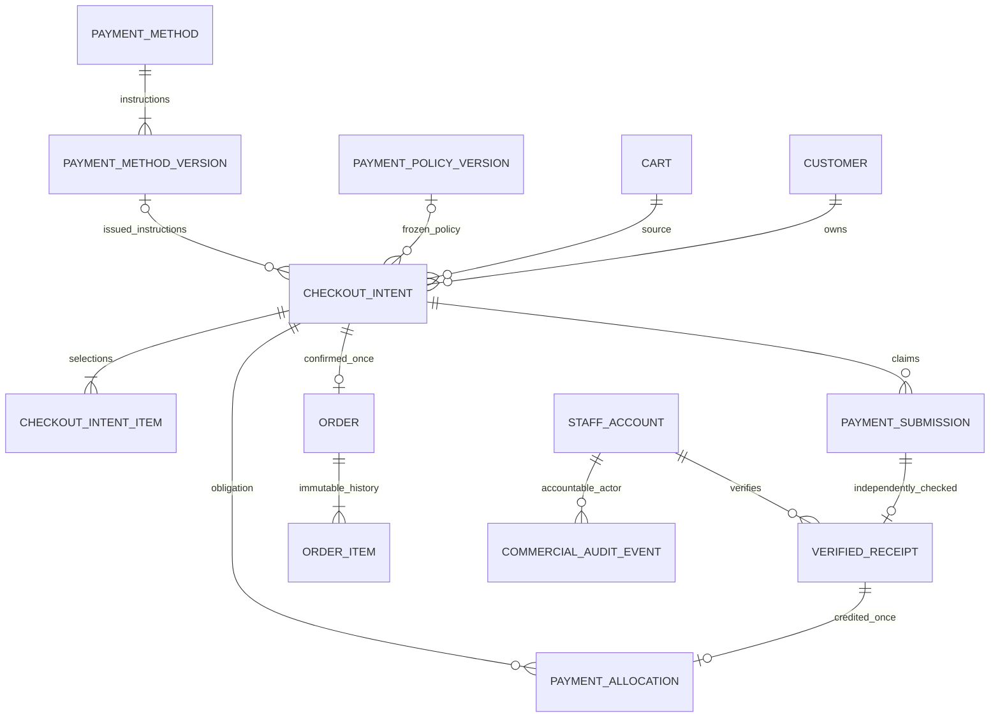
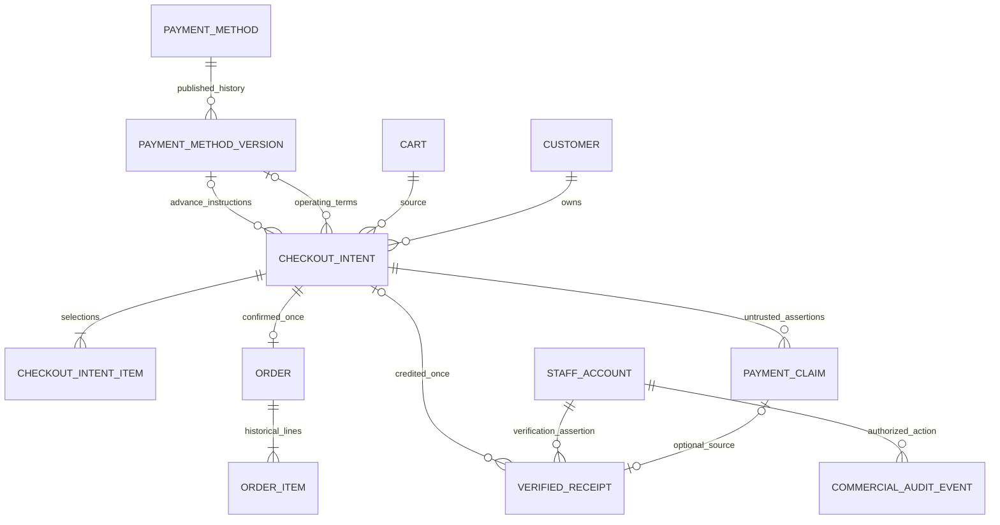

# Phase 05 - Checkout, Orders and Manual Payments Design Gate

Date: 2026-10-11 (Asia/Damascus).
Status: **PHASE 5 — DESIGN APPROVAL REQUIRED**.
Authorization: phase5.md sections 1/28/29 permit read-only inspection and this design document only. All new states, schemas, APIs, limits and commercial choices below are **PROPOSALS: NOT IMPLEMENTED / NOT APPROVED**.

Evidence: **CONFIRMED** means observed source/runtime evidence; **POTENTIAL** means a risk hypothesis; **NEEDS VERIFICATION** means not established. Decision labels: **APPROVED**, **TECHNICAL CHOICE**, **BUSINESS CLARIFICATION REQUIRED**, **ARCHITECTURAL DECISION REQUIRED**, **DEFERRED**. A recommendation is not owner consent.

## 1. Verified repository and database baseline

**CONFIRMED:** live GitHub main is `6ff053a36d593500e6234ab6bddec2efd73112fa`. [PR #2](https://github.com/NabilAlsaidaly/Pharma/pull/2) was merged by the owner at 2026-10-11T08:53:38Z. Local HEAD is `c9992f51765241d9e968b3b8b7168dbcdcc896e3`, branch `feature/favorites-cart-foundation`; local main remains `95fb9d7df09c933d8fcdfb9d05db636894f3e565`. GitHub main and local HEAD have the same Git tree `1f637a597b9e1bb53281b8b2d8c8e88cf6dd0e86`, independently verified through GitHub commit data. Source contents match merged main; local history needs synchronization before future implementation. Initial workspace clean. No branch switch/fetch/commit/push/merge performed in this gate. Preserve this report, verify current main again, safely fast-forward local main and create a separate feature branch only for approved implementation.

Exact-main [Backend CI 38126419707](https://github.com/NabilAlsaidaly/Pharma/actions/runs/38126419707) completed/success on PHP8.4/MySQL8.4: **134 tests / 1014 assertions**, Composer validation/platform/audit, Pint and PHPStan passed. These are fetched actual CI results, not a new local test run. Tests were inspected, not rerun: their setup performs isolated migrations, outside this read-only database gate. No Phase5 test has run.

Actual development database inspected inside `SET TRANSACTION READ ONLY`, then a transaction finally rolled back without writes: `sumaya_pharma`, MySQL **9.7.0**, **REPEATABLE-READ**, eleven tables; file cache/session, sync queue.

| Evidence | Observed value |
| --- | --- |
| customers | count1; nine columns; full sorted-row SHA256 `bfd1fec4fa98a4844988f217c4a4a887a41861e2f5559397fea314cf8184ab6c` |
| brands/products/product_variants/product_images/concerns/concern_product | each count0 |
| favorites/carts/cart_items | each count0 |
| each empty table above | SHA256 `4f53cda18c2baa0c0354bb5f9a3ecbe5ed12ab4d8e11ba873c2f11161202b945` |
| migrations | three rows, batches1/2/3: Customers, Catalog, Favorites/Cart; row hash `5c9422ec482384cc6689955898253f4d685c9b1838aab70325b935c7314a49f5` |
| staff/Checkout/Order/Payment/inventory tables | absent |

No real Customer/profile values or credentials printed. First generic inspection incorrectly assumed an id on favorites and failed with MySQL1054; corrected to actual PRIMARY-key sorting, including compound keys. This was an inspection error, not a schema defect. Sandbox GitHub access failed; approved read-only access succeeded. An oversized document-creation command exceeded Windows command length; native file patching was used instead. None of these failures caused business or database changes.

Final read-only preservation check passed: Customer count/hash and full column definitions match the Phase4 baseline; migration count/hash unchanged and all nine Catalog/collection tables remain empty. Customer hashing uses the prior `json_encode(..., JSON_THROW_ON_ERROR)` serialization; unescaped Unicode/slashes produce a different digest of the same rows and are not comparable to that baseline. Document validation passed all thirty numbered sections, D1-D12, approval status, balanced code fences and relative links. Git diff and staged diff are empty; only this new report is untracked.

## 2. Sources reviewed and precedence

Reviewed README, Composer metadata/lock, three migrations, database/auth/Sanctum/CORS/session settings, API conventions, Catalog Product/Variant persistence/selection reader, Cart operations/evaluator/snapshot, Identity active-customer middleware, accepted ADRs001-017, module boundaries, Phase0-4 reports/design gates, isolated MySQL test guards, independent-process concurrency tests and CI configuration. Orders/Payments contain scaffold markers only; System Console is an independent empty operational package.

Especially [ADR-005](../adr/ADR-005-manual-payments.md), [PAY-001 ADR-015](../adr/ADR-015-flexible-payment-before-order.md), [ADR-016](../adr/ADR-016-approved-catalog-foundation.md), [ADR-017](../adr/ADR-017-approved-favorites-cart-foundation.md), [payment rule](../architecture/payment-before-order-rule.md), [Cart compatibility](../architecture/cart-checkout-compatibility.md), [Catalog compatibility](../architecture/catalog-checkout-compatibility.md), [Cart API](../api/cart.md).

Original Desktop sources:

| Source | Read-only evidence |
| --- | --- |
| Sumaya_Pharma_SRS_v2.0_Arabic.docx | text/table paragraphs extracted; SHA256 `a58bd441e3aded16aca4d97942d6e7adb64766bba9137cfde3dfaf17b01f181f` |
| Sumaya_Pharma_SRS_v2_Arabic_Professional.docx | corroborating numbered requirements; SHA256 `0b4e5d709b486beefc36e4f231b322f301f0e3095aed42163f75ea28b9974c92` |
| Sumaya_Pharma_SRS.pdf | accessible/listed; contents/diagrams not inspected or cited |
| design/UML ZIP packages | accessible/listed; diagrams not inspected or relied upon |

Location: `C:/Users/nabil/Desktop/sumaiya/`. The doc skill text-extraction fallback was used; LibreOffice/Poppler commands unavailable. Word pagination/visual fidelity was not verified; no source document modified. Earlier reports saying SRS was not found describe historical repository access, not current Desktop access.

Precedence: explicit phase5.md scope and accepted PAY-001/ADRs, then compatible SRS, then unapproved recommendations. README and some old compatibility/ADR text still describe pre-Phase4 capabilities; code/current merged reports determine implemented state. No historical document silently rewritten. ADR-018 is next available, but must not be marked accepted before approval.

## 3. Existing implemented capabilities

**CONFIRMED:** Google-sub customer identity, UUIDv7, active/suspended customer guard, session Sanctum/CSRF/exact-origin CORS and safe API/request-ID envelope. No staff account/guard/RBAC. Google login does not verify phone or authorize verification.

Catalog supplies optional exact DECIMAL(18,2) USD/SYP prices, Product/Brand visibility and V1 effective availability. Simple Product owns price; selected Variant owns price otherwise, without inheritance. Model writes serialize parent price ownership; uncontrolled raw/bulk updates can bypass that cross-table rule. No physical stock quantities.

Cart saves selections and current independent estimates, not price/payment promises. Hidden/unpriced/unavailable selections may remain; on_request or a price in only the other currency is insufficient Checkout eligibility. Customer-first locks, selection uniqueness and aggregate versions are useful foundations. Cart R1 intentionally repeated POST increments must not become financial POST semantics.

**DEFERRED:** Checkout, privileged auth/configuration, payments/evidence, Orders, refunds, Delivery, inventory, management UI and System Console implementation.

## 4. Accepted business rules

**APPROVED:** manual external payments (ADR-005), no active gateway. PAY-001: no Order confirmation or reservation/allocation before independent verification of required full payment100% or business-configured deposit strictly0<p<100. Customers cannot override the percentage. Business Management owns policy/verification; relevant policy must be snapshotted. Proof/claimed payment is not verified funds. Final availability/fulfillment recheck remains necessary; atomic inventory allocation applies only where real tracking exists.

**APPROVED:** P1/C2/V1/S1 and Phase4D1-D6, including null versus zero, no conversion, exact selection, hidden safety and technical limits. Quantity2147483647 is representation safety, not purchase authorization. Payable Checkout needs approved commercial quantity limits or explicit human quantity review; do not inherit the technical maximum as commercial permission.

## 5. Historical SRS conflicts and reconciliation

Paragraphs count Word XML w:p elements, including table cells, not rendered pages.

| SRS location | Treatment and precedence |
| --- | --- |
| FR-ORD-047 P750-758; UC-05 P2566-2577 | direct Cart -> validation -> Order/Items -> clear/update Cart conflicts with PAY-001. Preliminary result must be Intent; Order only after verified required funds and approved final fulfillment. Cart handling becomes D12. |
| FR-ORD-048 P763-771 | name/phone/email/city/address and optional notes, Google prefilling retained as candidates; precise mandatory/conditional fields need D10. |
| FR-ORD-049 P776-784 | optional phone/city/address profile convenience not implemented; recommend immutable submission contact, no Customer/profile writes; phone never Google-verified. |
| FR-ORD-050/051 P789-812 | historical contact/Product/Variant/name/price/currency/quantity snapshots retained; freeze financial quote at approved issuance, Order copies accepted history rather than current profile/Catalog. |
| FR-ORD-052/053 P815-836 | atomic complete Order and duplicate prevention retained and extended to receipt/credit/confirmation. |
| FR-ORD-054/055 P841-862 | New/Contacted before Confirmed belong on preliminary request; recommend Order starts Confirmed. Legacy names require explicit unconfirmed semantics, not reservation. |
| FR-PAY-056-058 P868-904 | manual payment, Sham Cash QR/instructions, Al-Haram recipient/phone/instructions are historical candidates; owner must reconfirm methods/destinations/procedures. No working external integration inferred. |
| FR-PAY-059 P907-917; UC-07 P2594-2606 | authorized audited manual verification agrees with PAY-001; separate claim review from confirmed receipt and fulfillment. |

No inspected source specifies approved deposit percentage, rounding, expiry duration, shipping fee, authoritative reference namespace, commercial quantity maximum or automatic refund. They remain unresolved.

## 6. Unresolved decisions and confirmed blockers

| Finding | Classification / severity | Evidence, effect and correction |
| --- | --- | --- |
| P5-AUTH-01 | CONFIRMED dependency/P1 | only customer guard/provider; no staff authorization. Block privileged verification/confirmation until separate approved Identity/RBAC. Future negative/permission tests must prove it. |
| P5-FULFILL-02 | CONFIRMED dependency/P1 | no on-hand/warehouse/ledger/allocation implementation. Block automatic confirmation until approved authoritative fulfillment. No fake counter or atomic-allocation claim. |
| P5-FINANCE-03 | CONFIRMED unresolved policy/P1 | precision/rounding, policy publication, expiry, compensation, quantity and charges unspecified. Payment instructions fail closed until approved. |
| P5-HISTORY-04 | CONFIRMED synchronization/P2 | local main behind merged main, source contents identical. Preserve gate and base future branch on freshly verified main. |
| P5-PERSIST-05 | POTENTIAL integration risk/P2 | future raw/bulk Catalog writes or reversed lock order can bypass invariants. Preserve model/parent-lock boundary and test future management writers; no refactor now. |

No new confirmed defect in existing Phase4 behavior was established. These dependencies are not authorization to build staff/inventory/payment features.

## 7. Recommended release boundaries

**ARCHITECTURAL DECISION REQUIRED, recommend option B:**

1. **5A:** current non-binding Checkout evaluation plus preliminary non-payable request if approved. Customer currency/contact/Cart-version/selection validation and scoped idempotency. No instructions, deposit promise, Order or allocation. Binding quoted_total/required_payment remain null before trusted issuance, never zero/free; display estimates can be computed without persisting a fictitious quote commitment.
2. **Staff prerequisite:** separately approved secure Identity/RBAC/provisioning/recovery/MFA, privileged immutable policy/method publication. Minimal private API or approved CLI may precede UI; authority cannot be skipped.
3. **5B:** approved quote issuance and manual claim/receipt reconciliation, after financial/contact/fulfillment policies. Independent staff verification; held/unfulfillable/mismatched funds remain resolution cases.
4. **5C:** confirmation only after safe final fulfillment/compensation/lifecycle decisions; atomic one Order/Intent, immutable snapshots and financial links. Actual stock allocation only if approved inventory exists.

Alternative A staff-first then complete Checkout gives earlier end-to-end assurance but larger scope. Alternative C evaluation-only waits on all persistence/payment execution: smallest release, no actionable purchase. 5A alone is not a completed purchasing flow.

## 8. Administrative authority dependency

**PROPOSAL:** independent StaffAccount/provider/guard/session context. Granular permissions: policies.publish, payment_methods.manage, proofs.view, payments.verify, fulfillment.attest, orders.confirm, financial_resolution.manage, audit.read. Never broaden customer Sanctum into an ambiguous guard union or grant staff via caller role/email.

D2 choices: invite-only approved staff SSO with enforced MFA/stable external subject, or separately designed local credentials+MFA/recovery. Recommend SSO only if an actual approved provider can enforce it; otherwise require explicit local model approval. No provider or MFA is presumed working. Initial provisioning needs a secure approved operator ceremony, not public signup/hard-coded UUID/shared password/secret URL/dev bypass.

Recheck active staff, current permission and required auth recency inside financial transactions after any remote review. Separate sessions/cookies/topology from customer authentication and test suspension/revocation. Independent verification means independent evidence of funds, not necessarily two people: maker-checker is a separate owner option. Recommend prohibit self-verification and decide whether verifier and fulfillment operator must be distinct. Audit actor/time/request-ID/basis, not tokens. Management owns these capabilities, not System Console.

## 9. Inventory and fulfillment dependency

Before asking for payment, require approved exact-selection quantity/fulfillability assessment or defer instructions. on_request needs explicit business resolution. After verification recheck current eligibility and actual fulfillability, not merely Catalog available.

D6 options: quantitative inventory before automation; explicitly approved authoritative external/manual procedure; requests-only. Recommend requests-only until one final authority is approved. Customer/Intent locks prevent duplicate effects per obligation, not overselling across Customers. A staff assertion is not a stock ledger or exclusive allocation.

If manual confirmation is accepted, record actor, quote/item quantities, evidence/time and external checks; disclose absence of atomic on-hand accounting. Operations must prevent contradictory fulfillment decisions externally. If that cannot be justified, hold genuine funds in needs_resolution without Order. Real inventory needs separate ledger/allocation/cross-customer race tests; never add a fake Catalog stock counter.

## 10. Checkout Intent lifecycle

**PROPOSAL:** preliminary aggregate in Orders, Payments owns financial facts. Focused Application operations/ports rather than a speculative new Checkout module or generic repositories. A future Cart-owned locked-selection boundary must atomically validate source version; Cart GET snapshot is not itself a Checkout command.

| State | Actor/guards and permitted outcome |
| --- | --- |
| draft/review_requested | owned non-payable submission; customer may cancel/correct under approved version rules; staff may issue quote |
| awaiting_payment | trusted issuance only after exact prices/quantity/policy/method/charges/fulfillability; snapshots frozen, claims allowed |
| ready_to_confirm | verified required allocation and final approved guards; privileged confirmation only |
| review_after_funds | funds received but expired/mismatched/changed/unfulfillable; no silent repricing/confirmation |
| confirmed | exactly one complete Order committed; terminal commercial outcome |
| expired/cancelled/superseded | closed to payable actions; late genuine receipt remains a separate financial fact requiring resolution |

Versions protect changes. Before issuance, approved draft correction or replacement request is possible. After issuance recommend new Intent linking superseded original, not overwriting quote/contact history. After funds, correction/reassignment requires audited resolution/customer consent. No invented15-minute/24-hour validity. Terminal commercial state does not imply no money was received.

## 11. Payment lifecycle

Separate **submission review**, **verified receipt**, **allocation/resolution**. Proposed submission states submitted -> under_review -> accepted/rejected; disputed/needs_information only if approved. Customer reference/image/amount/time are claims, never accepted or actual received facts. Independent provider/account evidence must establish destination/currency/amount/receipt identity. Rejection of a claim does not prove no money arrived.

Receipt is append-only with trusted identity, actual amount/currency/time, verifier and basis. A second reviewer cannot overwrite it as rejected or edit amount. Correction requires separately authorized compensating facts. Receipt/review/approved allocation commit atomically; later Order failure does not erase a receipt already committed.

Allocation credits one receipt once to an approved obligation initially. Unallocated/held funds require resolution. Deposit satisfied is not full settlement. Cancellation/expiry cannot delete money history. Refund is not a Customer cancellation status; no refund ledger/workflow implemented here.

## 12. Order lifecycle

Recommend D11: no Order row before confirmation. SRS New/Contacted become Intent review/contact states; Order begins confirmed. Future proposed confirmed -> preparing -> out_for_delivery -> delivered, plus authorized cancellation; terminal delivered/cancelled cannot reopen arbitrarily. Delivery transitions remain outside5A/5B.

Privileged confirmation requires independently verified required funds plus final approved fulfillment. Unique Intent FK ensures one Order. Order/items/snapshots/financial links/audit commit together, with real allocation only if implemented. Retry returns existing Order, no partial records. Customer cannot confirm/change state. Alternative legacy unconfirmed Orders is possible only with explicit semantics and is less clear under PAY-001.

Historical contact/policy/line amounts immutable. Operational state/version may change under approved rules. Corrections after confirmation need a separate approved amendment, not rewriting history or mixing payment status with delivery status.

## 13. Payment policy model

**APPROVED authority; PROPOSED storage:** immutable policy versions with full/deposit mode, exact percentage, scale/rounding rule, publisher/time/approval. CHECK full=100 or0<deposit<100. Locked current/scope pointer selects published version; no public editing or hard-coded default percentage. Full-only first release is an owner choice.

Issued Intent snapshots version plus applicable percentage/rules/required amount. These are historical facts, not independently editable live settings. New publications affect future quotes only. Before trusted configuration exists,5A remains non-payable. Privileged approved CLI may precede panel UI, but .env is not hidden business administration. Owner must approve basis including fulfillment charges and any other component; absence is not zero. Quote hashing helps reproducibility, not proof of funds.

## 14. Price/currency/contact/instruction snapshots

Customer chooses exactly USD or SYP. Every payable line needs positive exact selected-currency price; missing/zero/hidden/unavailable/invalid selection blocks a complete quote. No conversion, range fallback or partial payable total. Resolve on_request through approved business process before payment.

Draft selection/contact is preliminary; estimate is not commitment. Trusted issuance rechecks and freezes exact Product/Variant identity/names/unit price/quantity/currency, approved charge components, contact/fulfillment, policy and issued instruction version. Current Cart amount is never trusted after change. Frozen quote unaffected by later Cart/Profile edits; new desired selections require new quote.

Recommend honoring approved issued price within an owner-defined window, subject to fulfillability; do not unilaterally impose price increase after transfer. Catalog hidden/unavailable/invalid at final validation blocks and enters review. Historical disclosure of now-hidden names needs D5 approval; meanwhile retain internal history and redact current hidden metadata. Confirmed Order copies accepted quote, not today's Catalog. Remote checks never occur while holding SQL locks.

## 15. Amounts, precision and rounding

**TECHNICAL CHOICE:** existing brick/math decimal arithmetic and canonical strings, no floats. **D4 BUSINESS CLARIFICATION REQUIRED:** currency/provider scale/increment, deposit rounding and mismatch rules. Catalog scale2 does not prove manual providers accept hundredths of SYP.

Candidate amounts DECIMAL(38,2), percentage DECIMAL(7,4), bounded checks. Wider totals prevent overflow when DECIMAL(18,2) unit prices multiply technical quantities/200lines. Proposed schema only; adjust before migration if approved increments require different scale. Validate exact representability; never rely on MySQL silent rounding/truncation or integer casts. These bounds are not purchase limits.

For complete approved obligation T, percentage p, payment increment q: R=round_to_increment(T*p/100,q,approved_mode). Full payment R=T only if representable; otherwise reject/review. Deposit choices: ceiling ensures at least mathematical percentage but can collect an extra minimum unit; half-up can fall below threshold; exact-only rejects fractional results. Recommend ceiling deposits **subject to explicit approval**, reject unrepresentable full totals.

Example T10.01,p30%,q0.01: raw3.003 -> ceiling3.01 versus half-up3.00 or exact-only rejection. q1 changes result materially. No currency increment/percentage finalized. Aggregate exact lines first, then apply approved rule once. Actual received amount is independent fact; allocated P drives outstanding=max(T-P,0), with excess separately visible/held, not hidden as negative balance. Required deposit satisfied leaves balance owing. Cross-currency funds require reconciliation, no inferred exchange rate.

## 16. Manual methods and configuration

D7 must reconfirm Sham Cash/Al-Haram and actual instructions/destinations/currencies. Historical descriptions are not live integrations. No provider SDK/API/gateway proposed.

Separate enabled/current-version pointer from immutable instruction version; freeze issued version in Intent. Changes publish with audit/approved recent staff authentication, not overwrite where money may already be sent. Stable destination/account identity survives version rotation for duplicate receipt detection. Emergency disablement stops new issuance and applies approved review to open instructions; incoming funds still reconciled.

QR is instruction data only, never payment verification. If published, serving must prevent script content/substitution; this is separate from private proof storage. Actual recipients/configuration and operational method evidence are NEEDS VERIFICATION. Commercial methods belong to Payments/management, not System Console.

## 17. Proof and independent receipt reconciliation

Recommend reference-first5B; upload optional separately approved scope. Customer supplies method version, bounded claimed reference/amount/currency/time and optional evidence. Never accepts verified amount/status/verifier, destination override or deposit policy from Customer. No reference-enumeration API.

Do not assume global reference uniqueness. Trusted identity from authoritative provider/account evidence: namespace + stable destination/account + actual receipt key, not caller string or rotating instruction version. Duplicate claims may exist but credit only once. If reliable identity cannot be established, hold for reconciliation. Hashing untrusted reference does not prove uniqueness. Provider canonicalization/case/time scope needs actual verification. Bounded binary tuple or collision-checked canonical identity hash are technical alternatives, not finalized.

If upload approved: propose JPEG/PNG only, bounded bytes/dimensions/count (candidate5MiB, not adopted), decoded MIME/content validation, random keys, private disk outside webroot, quarantine, authorized staff/customer access, safe attachment headers and EXIF minimization. No SVG/HTML/executable/public proof URL. Verify scanning/re-encoding capability; do not claim scans absent infrastructure. Upload before short DB registration; orphan cleanup and retention require approved policy. Exact legal/privacy retention needs owner/professional review, no invented period. No proof/statement contents in logs. Independent evidence, not image authenticity alone, verifies funds.

## 18. Compensation, cancellation and mismatches

D8 must govern under/overpayment, wrong currency/destination, late funds, cancellation, unfulfillable purchases and verifier errors. Recommend recorded hold/reconciliation, not automatic forfeiture/refund/substitution/repricing. Actual funds remain append-only even without Order.

Initial alternatives: one verified receipt meeting requirement versus accumulated installments. Recommend single receipt first unless real operations justify accumulation. Additional genuine funds must still be recorded as held, not denied as fact. Multiple-credit design needs receipt uniqueness, Intent mutex, currency match and exact sums. Deposit balance collection/delivery terms need approval.

Rejected screenshot may coexist with later discovered genuine funds: append trusted review/receipt rather than delete prior decision. Confirm failure preserves verified funds and supports safe retry. Refund/reversal requires distinct compensating references, permission/audit/idempotency; no negative adjustment silently edits receipt. Customer consent, replacement choice, transfer fees and correction/refund procedures remain open.

## 19. Candidate ERD

**PROPOSAL ONLY**, staged schema; staff and any inventory are separately approved. One allocation source governs credit; current Order paid/balance views derive from it, not independently writable counters.

Draft policy/method FKs nullable only while non-payable. Product/Variant identities use restrictive references; order copies are intentional history, not competing mutable prices. Current policy pointer and conditional proof metadata below; no generic idempotency table mandated.

## 20. Candidate schema and constraints

UUIDv7 server IDs, existing char36 convention, restrictive FKs, UTC timestamps, bounded canonical amounts/versions. All fields **candidate**, no migration generated.

| Table/stage | Candidate fields/integrity |
| --- | --- |
| checkout_intents/5A | customer/cart FKs, source Cart version, state/version, selected currency, contact/fulfillment submission, operation UUID/fingerprint, timestamps, optional supersedes FK. UNIQUE(customer,operation), customer/time/id and state/time/id indexes. Quote/policy/method fields unset until5B issuance. |
| checkout_intent_items/5A->5B | Intent FK, source CartItem identity/quantity metadata, Product/optional Variant composite FK, signed positive quantity, normalized selection uniqueness. Frozen names/unit/line price filled once on payable issuance. Currency owned by Intent. |
| payment_policy_versions + current pointer | immutable full/deposit percentage/rule/version/publisher/time; constrained percentage; current singleton/scope FK changed only by privileged publication. |
| payment_methods/versions | stable code/account identity, enabled/current pointer; immutable instruction/recipient/currency/QR metadata versions/publisher; issued quote references exact version. |
| payment_submissions/5B | Intent/owned-operation identity/fingerprint, method version, claimed reference/currency/amount/time, review state/version; unique scoped operation; Intent/time/id and state/time/id indexes. |
| payment_evidence/conditional | submission FK, private random unique object key, detected type/size/digest/quarantine/time. No public URL; omit if reference-only. |
| verified_receipts/5B | source submission initial UNIQUE, trusted provider/account/receipt identity UNIQUE independent of instruction rotation, positive actual amount/currency/received time, verifier FK/basis/time. Immutable after receipt established. |
| payment_allocations/5B | receipt FK UNIQUE, Intent FK, exact amount/currency/actor/time; initial UNIQUE(Intent) only if single-receipt choice approved. Receipt lock/application guards enforce sums/currency; later installment support needs approved change. |
| orders/5C | Intent FK UNIQUE, Customer FK, confirmed state/version, immutable quote/contact/policy/required/totals and actor/time. Confirmation-time paid snapshot explicitly historical; current balance derives from allocations. |
| order_items/5C | Order FK, frozen identity/name/unit price/quantity/line amount, restrictive Product/Variant references, unique source-Intent item/selection. No Catalog overwrite. |
| commercial_audit_events/staged | explicit Customer/Staff actor FKs with exactly-one-actor CHECK, action, aggregate/version/result identity, prior/next state, request/operation identity/fingerprint, time and redacted bounded basis. Append-only; aggregate/time and staff/time indexes. Unique(actor scope,action,operation) for staff commands. |

Payable states require complete frozen policy/price/contact/instruction/approved-charge fields; non-payable null amount does not mean free. State CHECK/ENUM and monetary bounds after approval. Cross-table sums, authority, legal transitions and immutability need application transactions; MySQL CHECK cannot magically enforce aggregate balances. Restrictive deletion preserves history.

Optional generated active_customer_id UNIQUE can enforce one active Intent/customer only if D9 accepts it, with explicit state list and real9.7/8.4 tests. Composite Variant FK reuses current approved Catalog index. Customer creation/submission keys live on their aggregates; staff issuance/verification/rejection/confirmation keys and fingerprints are recorded atomically with result links on the corresponding commercial audit event, with uniqueness across targets of the same action. Same key targeting another aggregate conflicts, not a second financial action. Regular non-command audit events can omit operation identity. This reuses the required business audit trail, not a universal request framework. Staff/RBAC and real inventory schema remain separate. UUIDv7 is not authorization or secrecy.

## 21. Proposed REST API and validation

**ALL UNIMPLEMENTED.** Preserve /api/v1, success/error envelope, Request-ID, Customer session/CSRF/exact CORS. Owner scope comes from session, not body. Non-owned/unknown Intent/submission/Order uniformly404. No public financial record endpoint; staff-only facts omitted from Customer resources.

| Candidate route | Actor/stage and accepted inputs |
| --- | --- |
| POST /api/v1/checkout/evaluations | active Customer/5A; expected_cart_version, USD/SYP, approved contact/fulfillment; authoritative non-binding evaluation, no payment/Order |
| POST /api/v1/checkout/intents | active Customer/5A; operation UUID, expected Cart version, currency/contact; idempotent non-payable submission |
| GET /api/v1/checkout/intents and /{id} | own Customer/5A; bounded page/per_page, safe owned state |
| POST /api/v1/checkout/intents/{id}/cancellations | own Customer/approved scope; operation/version; guarded, no automatic refund |
| GET /api/v1/checkout/intents/{id}/payment-instructions | own Customer/5B; only complete approved payable issued quote; otherwise safe conflict |
| POST /api/v1/checkout/intents/{id}/payment-submissions | own Customer/5B; operation/version, issued method version, claimed reference/amount/currency/time, optional approved evidence token |
| GET /api/v1/checkout/intents/{id}/payment-submissions | own Customer/5B; bounded safe claim/review status, no statement/other-customer details |
| GET /api/v1/orders and /{id} | own Customer/5C; bounded confirmed history, no confirmation write |
| POST /api/v1/management/checkout-intents/{id}/quote-issuance | approved staff/5B; operation/version/review decision, server derives policy/prices |
| POST /api/v1/management/payment-submissions/{id}/verifications or /rejections | payments.verify/5B; operation/version plus independently established receipt facts/basis or rejection reason; never Customer route |
| POST /api/v1/management/checkout-intents/{id}/confirmations | orders.confirm + fulfillment authority/5C; operation/version/approved attestation; server validates funds/snapshots |

Policy/method privileged publication and private evidence routes conditional on separately approved authority/upload scope. No generic public financial CRUD. Strict unknown-field rejection: client Product price/total/deposit/verified amount/status/Customer/staff/stock not accepted. Contact prefilling cannot change account identity. Candidate technical JSON16KiB/page12max48 may reuse existing bounds, with localized approved financial throttles; uploads need separate limits. Safe422/409/413/429/503 through current envelope; no provider messages. GET never cleans up/reconciles silently.

## 22. Security and privacy model

Core invariants: server-owned Customer/staff authority, authoritative quote, independent received-fund facts, one receipt credit and one Order/Intent. A UUID/reference/image never authorizes confirmation. A replay cannot bypass ownership or a terminal state.

Staff separate guard/session/MFA/topology; no email grant/caller role/admin UUID/shared verification password/secret URL/dev bypass. Publish destinations/policies through least privilege, recency and approved review controls. Proof-view permission does not imply verification permission. Current active authority checked at commit.

Duplicate/reference conflicts must not expose another Customer's funds. Do not log phone/address/proof/statement/token/full request. Safe HTTP envelopes alone do not ensure private SQL bindings are absent from exception reports: future financial persistence must redact reporting context and test deliberate failures before introducing contact/payment writes. Audit meaningful actor/time/state/basis with restricted views and privacy retention. Application append-only facts/audit are not tamper-proof against DB administrators; future least-privilege DB accounts/backups/access monitoring must be verified. Do not invent legal retention requirements or change reusable System Console.

## 23. Locking and transaction boundaries

**PROPOSED, not tested:** preserve existing Customer -> Cart -> sorted Product/Variant/Brand locking. Extended total order: staff authority rows when applicable -> trusted receipt identity/receipt if allocating/verifying -> Customer -> Cart if touched -> Intent(s) sorted -> current policy/method pointer if issuing -> sorted Products -> Variants -> Brands -> affected selection rows -> submission/allocation/order/audit. Immutable facts need no excessive locks. Every future staff/policy/Catalog/refund writer must use compatible order; test actual wait/deadlock behavior before adoption.

Creation: lock Customer/Cart, validate expected version, bounded exact selection/current eligibility, operation identity, then store preliminary Intent/items/contact/audit atomically. No Cart mutation/financial promise.

Issuance: recheck staff/Intent, current Catalog, quantity/fulfillment/charges/policy/method; freeze unset quote fields exactly once and version/audit in one transaction. No issued history overwrite.

Verification: independent external account review outside SQL. Then recheck active authority/state, claim trusted receipt identity, lock relevant aggregates; record receipt/review/approved credit/audit atomically. Genuine expired/mismatched receipt commits into needs_resolution without automatic Order/credit. Separate confirmation failure cannot erase established funds.

Confirmation: authority, Customer/Cart if D12 cleanup, Intent, current Catalog/lines, verified allocations under Intent mutex, final required funds/quote/fulfillment/contact guards; unique complete Order/items/history/audit commit together. Actual inventory locks/allocation only once implemented. Rollback leaves no partial Order or partial Cart cleanup, without undoing prior receipt. Bounded same-key contention retries, no Redis correctness dependency. Uploads/remote calls/emails/human review never run under SQL locks.

## 24. Operation-level idempotency

Required proposal: scoped operation UUID and fingerprint on Intent/submission, staff operation/version on verification/confirmation. Canonical validated fingerprint includes relevant Cart version/currency/contact/fulfillment or trusted verification payload. Same key/same payload returns existing resource/effect; different payload409. Ownership never caller-selected.

Successful replay lookup precedes fresh Cart/expiry evaluation, so committed result remains discoverable after state changes. Different keys still cannot duplicate receipt credit/Order due durable business uniqueness. D9 one active Intent/customer is an optional approved business backstop; without it multiple obligations require deliberate UX/guards.

Commit succeeded/response lost: same-key retry returns same identity, not a fresh obligation. No automatically new key after uncertainty. Key/result retention must match approved history period; expiration/cache cleanup cannot reopen receipt/Order uniqueness. Focused business records suffice, not universal framework. Future authenticated provider callbacks require stable event identity but remain DEFERRED; Cart R1 is not used here.

## 25. Real concurrency and complete test plan

**NOT IMPLEMENTED / NOT RUN.** Future guards require testing+mysql+sumaya_pharma_test before destructive setup. Local9.7/CI8.4, separate PHP processes/connections, committed fixtures, row barriers/observed connection overlap and final committed checks; sequential calls do not prove concurrency.

| Race/scenario | Required invariant |
| --- | --- |
| same-key concurrent Intent | one aggregate/items set, same result; changed fingerprint conflicts |
| different-key submissions | accepted active-obligation rule enforced, no accidental duplicate obligation |
| two approvals; approve/reject | one guarded outcome/receipt/credit; no receipt rewritten/rejected afterward |
| two confirmations | one Order/Intent, complete lines, no duplicate credit/allocation |
| Cart edit versus submit | exact expected locked version or stale conflict; no mixed selections |
| Catalog price/Variant/visibility change versus issuance | coherent quote or rejection, parent locks/hidden safety retained |
| unavailable versus confirmation | final approved guards, no partial Order/false stock promise |
| verify after expiry | genuine receipt preserved, held/reviewed; no auto confirmation |
| Order failure after verified funds | receipt survives, Order absent, safe confirmation retry |
| two Customers same transfer | duplicate claims may exist, trusted identity credited once, no IDOR leak |
| multiple genuine receipts | unsupported extra held or exact approved accumulation; no double credit |
| response loss after commit | same operation replays committed effect |
| future cross-customer inventory race | only test once real ledger exists; no double allocation or partial commit |

Also test guest/suspended/customer/staff isolation; actual CSRF; permission/MFA revocation; forged amounts/status; currency/missing/zero price/Variant ownership; exact deposit/full precision and representability; immutable profile/Catalog/policy/instruction snapshots; expiry/contact correction; independent proof versus receipt; upload privacy/quarantine/limits if approved; safe logs/errors; bounded histories/throttles; transition/cancellation/compensation guards; no premature reservation and no partial Order. Preserve existing134tests unchanged. Future counts/results require actual execution; no Phase5 passing claim fabricated.

## 26. Performance and indexes

Bound source/draft items explicitly; existing Cart cap200 does not protect arbitrary imports. Batch Catalog reads/quote-item inserts, no queries per item. Purposeful Customer/time, review-state/time, Intent/result/receipt uniqueness indexes; stable history pagination. Minimize selected columns and round trips, short transactions.

Measure small/larger datasets for creation/replay/verification/confirmation/history with actual SQL and EXPLAIN after schema approval. Current Cart6queries at2vs50 and Favorite4 are baseline only, not Checkout benchmarks. No Phase5 plan/throughput proof exists. Cache immutable versions only if justified later; activation/receipt credits/confirmation remain MySQL-authoritative. File-cache throttling is not proven multi-server consistency. No speculative Redis/microservices/queue abstraction.

## 27. Failure and recovery

| Failure | Proposed safe recovery |
| --- | --- |
| policy/charges/staff/provider identity absent | non-payable request/review, no invented default |
| price changes before issuance | current re-evaluation and explicit approved quote |
| price/instructions change after issuance | preserve issued version/approved commitment; late funds held, no overwrite |
| remote verification timeout | uncertainty is not receipt; retry independent check outside DB |
| upload orphan | private unreferenced object/approved cleanup, no financial credit |
| duplicate reference/operation | safe scoped replay/flag, no other-customer disclosure |
| unfulfillable/late/cancelled/wrong funds | actual receipt retained, no automatic refund/substitution/Order |
| deadlock/exhausted retry | bounded stable-key retry or503, no partial effect |
| authority revoked mid-review | final authorization deny, retain established facts |
| network failure after commit | same-key result recovery |
| verification mistake discovered later | authorized compensating facts/review, not deleting receipt |

Define staff reconciliation ownership/customer communications with D8. Customer suspension after transfer never erases funds; existing Customer access rules remain while authorized staff reconcile. Refund/replacement/reallocation/transfer fees require explicit commercial consent/rules, not exception-handler guesses.

## 28. Redis assessment

**CONFIRMED:** local file cache/session, sync queue; no service installed/configured. Recommend MySQL constraints/row locks/operation identity for money. Redis is not prerequisite, ledger or verification authority.

Optional later notifications, private-proof scan/cleanup or reminders may use approved synchronous/manual operations or database-backed queues. If jobs needed, assess durable enqueue/outbox and retry evidence first; do not add infrastructure speculatively. Multi-node session/throttle topology remains NEEDS VERIFICATION separately from financial integrity. System Console stays untouched.

## 29. Implementation checkpoints after approval

None authorized now. Record selected D1-D12 and missing material parameters; only then accepted ADR-018, preserve report, safely synchronize latest main and separate feature. Before/after each approved forward migration, actual development DB/count/hash/schema evidence; guard isolated MySQL tests. Never fresh/reset/rollback/wipe/truncate development, regenerate IDs or edit OAuth/.env for convenience.

5A: exact non-payable/evaluation scope, owned version/contact/currency/lifecycle/idempotency; no required-money/free-payment implication. Evaluation-only alternative needs no tables.

Staff prerequisite: approved provisioning/recovery/MFA/permissions/session model, trusted policy/method publication and independent evidence procedures. Minimal adapter may omit UI but not authority.

5B: approved precision/policy/quote expiry/quantity/charges/fulfillability; claims versus receipts, namespace uniqueness, allocations and compensation holds; uploads only if approved. Full regressions/new MySQL concurrency/security, Pint/PHPStan/Composer checks, actual compatibility/data preservation/exact-head CI.

5C: authoritative final fulfillment, one complete Order/snapshots/financial links, approved lifecycle/Cart treatment. No atomic-stock claim without real tested ledger. Feature PR/owner review; no automatic deployment/merge or unrelated Delivery/System Console work.

## 30. Owner approval package and hard stop

Approve by manageable group A-D; all below are **UNAPPROVED**. Missing dependent parameters keep payable execution blocked. Do not reopen accepted PAY-001/Catalog/Cart rules.

| Group/decision | Options and recommendation | Benefits/trade-offs; security/schema/future consequences |
| --- | --- | --- |
| A/D1 Scope | **Recommend non-payable5A -> staff prerequisite ->5B -> gated5C**; alternatives staff-first or evaluation-only. | Small testable units, no unsafe authority; several releases, no complete purchase flow in5A. Determines nullable draft versus frozen financial schema. ARCHITECTURAL DECISION REQUIRED. |
| A/D2 Authority | **Independent invite-only staff auth/MFA/permissions**, approved SSO if available or separately designed local model; decide maker-checker. | Customer guard preserved; provisioning/recovery/session/audit scope required. Two-person controls add burden. No email-based grants/bypasses. ARCHITECTURAL DECISION REQUIRED. |
| B/D3 Policy | Full-only versus configurable deposit; **immutable privileged versions, no assumed initial value**. | Reproducible quotes, needs publication; supply mode/percentage/granularity/basis/effective scope. Snapshot policy/required amount. BUSINESS CLARIFICATION REQUIRED. |
| B/D4 Precision | Provider currency increments; ceiling/half-up/exact-only. **Recommend ceiling deposit, reject unrepresentable full total**, only with consent. | Avoid mathematical under-collection but extra minimum unit possible; supply USD/SYP increments/rules/tolerance, drives decimals/snapshots. BUSINESS CLARIFICATION REQUIRED. |
| B/D5 Commitment | Frozen issued quote/validity versus repricing with renewed consent or review-only. **Recommend honor quote within approved validity, no unilateral after-transfer repricing.** | Price-movement risk accepted explicitly; decide hidden history/contact/policy/instruction changes, immutable supersession. BUSINESS CLARIFICATION REQUIRED. |
| C/D6 Fulfillment | Real inventory, approved authoritative external/manual procedure, or requests-only. **No automatic confirmation with descriptive Catalog.** | Delays confirmation, may require compensation; decide on_request, quantity limits/human review, pre/post-payment assessment. No fake stock. ARCHITECTURAL+BUSINESS DECISION REQUIRED. |
| C/D7 Evidence | Reconfirm Sham Cash/Al-Haram/destinations/currencies; reference-only versus private images. **Recommend reference-first + independent authoritative receipt.** | Less upload scope, may need operational proof; supply actual identity/verification procedure and optional file/retention rules. No assumed provider API. BUSINESS CLARIFICATION REQUIRED. |
| C/D8 Compensation | Single receipt versus installments; automatic compensation versus privileged resolution. **Recommend single-receipt first, hold all mismatches/late/unfulfillable/cancelled funds.** | Simple credit invariant but manual workload; approve balance collection, excess/under/wrong funds/refunds/replacements/fees/customer consent. Ledger facts never erased. BUSINESS CLARIFICATION REQUIRED. |
| D/D9 Expiry/retry | Owner-defined quote validity/review-only; one versus several active obligations. **Recommend owner-defined expiry, one active Intent/customer and durable operation IDs.** | Bounds ambiguity but restricts parallel purchase; supply duration/late-funds/key retention. Conditional generated unique requires real MySQL proof. BUSINESS CLARIFICATION REQUIRED. |
| D/D10 Contact/delivery | Name/phone/email + mode-conditional city/address, optional notes/profile save. **Snapshot submission first, no Customer-profile change.** | Historical accuracy, reentry possible; specify mandatory fields, actual modes/charges/corrections/privacy. No phone verification/free delivery/pickup assumed. BUSINESS CLARIFICATION REQUIRED. |
| D/D11 Lifecycle | Order only after confirmation versus legacy unconfirmed records. **Intent owns New/Contacted; Order starts Confirmed.** | PAY-001 clear, SRS naming differs; approve actors/guards/terminal cancellation. Delivery transitions separately scoped. BUSINESS CLARIFICATION REQUIRED. |
| D/D12 Cart | Keep, selectively remove unchanged purchased lines, or subtract from changed Cart. **Recommend keep unchanged initially**, or explicitly approve version-matched selective cleanup. | Protects later edits; repeated intentional purchase/UX needs clarity. Never clear on Intent/proof/failure/expiry/cancel. Cleanup after confirmation atomic with locks/version. BUSINESS CLARIFICATION REQUIRED. |

Missing values are explicit: staff provider/auth/permissions/procedure; payment mode/percentage; currency increments/rounding; quote validity/late funds/retention; destinations/receipt namespace; compensation/installments/balance; actual fulfillment modes/charges/quantity authority; contact requirements; lifecycle/Cart behavior. Silence is not approval.

Only this report is created. No business tables/endpoints/staff/upload/Redis/Catalog/Cart changes, accepted new ADR, commit/push/deploy/merge or next-phase implementation. No inaccessible contents claimed reviewed, no proposed test claimed passing, no atomic inventory allocation claimed present.

**PHASE 5 — DESIGN APPROVAL REQUIRED**

Stop and await explicit owner approval of grouped decisions and material dependent parameters.

---

# OWNER BUSINESS CLARIFICATIONS — APPROVED

Revision date: 2026-10-11. Authority: `C:/Users/nabil/Desktop/sumaiya/phase5.1.md`, sections 2, 28, 32-35. **Approved requirements are incorporated; implementation is NOT authorized.** The entire first Design Gate above is preserved as historical analysis. Its unresolved-method/full-versus-deposit questions, proposed table inventory and 5A/5B/5C labels are superseded only where explicitly stated below. Read this revision for the current approval package. Evidence classifications retain their original meaning.

Historical document before this append: 51,571 bytes, SHA256 `a75b22a6983dece436909d09e8de886465bf08a325307726a8694e07780ba03d`. No accepted ADR, application source, migration, configuration, frontend or management capability is changed by this revision.

## R1. Business executive summary

Visitors browse freely. Google-authenticated Customers may save personal selections and submit purchase requests. The owner configures manual payment instructions, QR images and full, percentage, fixed or explicitly no-advance policies. Customers transfer money outside the website; an authorized operator checks actual receipt independently. No gateway or automatic provider confirmation exists.

An unpaid request never blocks products. COD without deposit remains a non-binding request awaiting owner review, not a confirmed Order. COD with deposit uses an enabled manual transfer method for the deposit and leaves the approved same-currency balance due at delivery. Verified required funds make confirmation eligible; fulfillment must still be checked. Current Catalog availability is descriptive and cannot guarantee the last physical unit.

Recommend a small first milestone: read-only, authenticated Checkout evaluation using exact current Cart selections and chosen currency. Persisted preliminary requests can follow once their contact/quantity/retention/active-request rules are approved. Staff, published configuration, payment verification and confirmed Orders are later, separate milestones. All implementation waits for explicit authorization.

## R2. Approved requirements and decision delta

**APPROVED NOW:** public Catalog browsing; existing Google login for Cart/Checkout; manual external payments without a gateway; owner-managed method activation, typed instructions, recipient information and QR; Sham Cash, Al-Haram and COD concepts; full payment, percentage deposit, currency-specific fixed deposit and explicit no-advance/non-reserving requests; COD with and without deposit; no reservation or confirmed Order before independently verified required funds; PAY-001 sequencing remains authoritative. Functional approval is not approval of current destinations, values, procedures or implementation.

| Previous decision | Current resolution | Remaining material dependency |
| --- | --- | --- |
| D1 Scope | PARTIALLY RESOLVED: design revision only is fully authorized; staged delivery direction clarified. | Exact first implementation milestone and persisted 5A scope require authorization. |
| D2 Authority | PARTIALLY RESOLVED: separate secure staff authority and owner control required. | Provider/MFA/provisioning/recovery, assigned capabilities and optional maker-checker. |
| D3 Policy | PARTIALLY RESOLVED: the old choice full-only versus deposit capability is FULLY RESOLVED; full/percentage/fixed/no-advance must be supportable. | Initial values, per-method precedence, increments, fixed-equals-total treatment and charge basis. |
| D4 Precision | UNRESOLVED: exact decimals required; no rounding rule approved. | USD/SYP settlement increments, percentage granularity and rounding/tolerance. |
| D5 Commitment | PARTIALLY RESOLVED: issued instructions and agreed amounts must not be overwritten by configuration changes. | Quote validity, price commitment exceptions, late transfers and historical Customer disclosure. |
| D6 Fulfillment | PARTIALLY RESOLVED: unpaid requests never reserve; no existing physical stock ledger. | Manual authority versus separate real inventory, on_request and commercial quantity limits. |
| D7 Methods/evidence | PARTIALLY RESOLVED: old reconfirmation of method concepts is FULLY RESOLVED; Sham Cash/Al-Haram/COD, configurable instructions/QR approved. | Actual currencies/destinations, reconciliation identity/procedure, proof requirement and media limits/retention. |
| D8 Compensation/balance | PARTIALLY RESOLVED: COD deposit can leave balance due at delivery; not paid automatically. | Collection authority/procedure, partial/extra/wrong funds, corrections/refunds/replacements/installments. |
| D9 Expiry/retry | PARTIALLY RESOLVED: durable Checkout/financial idempotency required. | Active-request limit, expiry/key retention and resubmission policy. |
| D10 Contact/delivery | UNRESOLVED parameters: approved conceptual entry step only. | Mandatory/conditional fields, actual delivery modes and fees. |
| D11 Lifecycle | PARTIALLY RESOLVED: preliminary request is not confirmed Order; no-advance COD confirmation/dispatch not authorized. | Post-confirmation lifecycle and explicit pre-payment COD dispatch decision. |
| D12 Cart | UNRESOLVED: no change to existing Cart semantics authorized. | Keep versus version-matched cleanup after successful confirmation. |

No whole D1-D12 group is fully approved merely because some capabilities are now settled. Removed questions are method existence, whether configurable deposits are wanted and whether no-deposit COD may create an unreserved request. Do not re-ask those. Do ask operational parameters affecting money, authority, fulfillment or the chosen first milestone.

## R3. Exact Guest and Customer access

**CONFIRMED SOURCE:** [API routes](../../routes/api.php), [Google callback](../../app/Domains/Identity/Interfaces/Http/Controllers/GoogleAuthenticationController.php), [safe return paths](../../app/Domains/Identity/Interfaces/Http/FrontendRedirect.php) and [customer guard](../../config/auth.php). Existing Catalog routes are public; favorites/cart use Sanctum plus active-Customer middleware. Google callback authenticates and redirects; it performs no Cart mutation. Return paths are sanitized relative paths combined with configured frontend origin.

Guest browsing stays public. A Guest attempting a personal mutation receives authentication failure, with no Favorites/Cart/Checkout record created. Future Next.js Add to Cart prompts existing Google login, returns to safe context, revalidates Product/Variant and requires an explicit authenticated add. No untrusted prices in OAuth state/session, callback add, guest persistence or password-based Customer identity. Frontend work is separately scoped. All future Customer financial resources are queried through authenticated ownership; guessed UUIDs receive the same safe404 as nonexistent resources.

## R4. Manual methods and distinct operating flows

Propose database-configured manual methods with stable identifier and a small validated kind: `manual_transfer` or `cod`. This describes behavior, not a code enum of every method/policy combination. Sham Cash and Al-Haram are manual transfers with owner-entered instructions; COD describes balance collection. New manual methods need configuration, not speculative provider adapters.

Candidate Checkout fields: `collection_flow=direct_transfer|cod`, selected operating-method version and, only if required, deposit-transfer instruction version. Direct transfer uses the selected Sham Cash/Al-Haram version for advance payment. COD policy comes from the selected COD configuration; an explicitly enabled compatible transfer method carries its deposit. **Do not apply the deposit rail's independent direct-purchase policy a second time.** A proposed explicit COD configuration lists permitted deposit transfer methods/currencies. This precedence/binding needs approval; no defaults or giant combination enum.

COD without advance payment has no deposit rail and no verified payment. COD with deposit freezes both COD terms and actual advance-transfer instructions. All outstanding balance remains in the same selected currency. Cash collection and transport integrations are not presumed implemented.

## R5. Owner-managed instructions, QR and version retention

Draft settings are editable only by authorized staff; publication creates an immutable configuration version. Method display name/description, bounded plain-text instructions, recipient name/contact, supported currencies, optional QR media reference and applicable policy are included. Additional fields use an explicit whitelist of bounded text/contact/instruction values; no arbitrary HTML, executable schema, unlimited JSON or speculative Al-Haram account/receipt format.

Method activation/current-version pointer is mutable and audited. Instruction versions and media used by issued quotes are retained and protected from deletion while referenced. Replacing/removing current QR creates a new version; old issued version still renders and reconciles. Disablement stops new issuance immediately; old money facts survive. Whether existing instructions remain payable after disablement requires approved validity rules; the safe interim outcome is review, never erasure or automatic forfeiture.

Payment instruction images are legitimate Customer-facing content, unlike private Customer proof. Propose random immutable keys, JPEG/PNG content decoding and type validation, bounded bytes/dimensions, re-encoding where supported, safe content headers and storage serving only the relevant instruction asset through an authorized or narrowly approved signed route. Public CDN exposure is an explicit deployment/privacy choice, not permission to publish proofs. No SVG/HTML/script or storage overwrite. Stage object first, publish DB reference atomically, clean orphan only by approved retention; storage failure leaves old version current. Exact size/count/retention/storage backend remain approval dependencies. No actual QR uploaded now.

## R6. Separate method, policy and historical facts

| Concept | Single responsibility and source of truth |
| --- | --- |
| Method | Enabled operating option and current published configuration pointer. |
| Policy | Validated full/percentage/fixed/no-advance value object embedded in the published version; not a second editable total. |
| Instruction | Historical destination/QR/text/currency version actually issued to this Customer. |
| Preliminary request | Owned selections/contact/flow; no physical allocation or financial receipt. |
| Claim | Customer's untrusted assertion and operator review outcome. |
| Verified receipt | Independently established amount/currency/destination/identity/basis, plus one-time attribution if valid. |
| Confirmation eligibility | Derived checks of policy, credited funds and fulfillment; not a stored stock promise. |
| Confirmed Order | Atomic historical commercial result after those guards; delivery and balance status remain distinct. |

Use focused Laravel application operations, current Catalog selection port and a narrowly defined Cart locked-selection boundary. Do not build general payment orchestration, provider SDKs, event sourcing, universal idempotency, generic repositories or new microservices.

## R7. Policy invariants and exact calculation

Let T be the complete positive approved payable amount, in exactly one currency, including only explicitly approved charges. Full: required advance R=T. Percentage: strictly0<p<100, R=approved_round(T*p/100,q). Fixed: currency-specific F>0 and F<=T, R=F exactly representable in approved increment q. No-advance: R=0 **only with explicitly published non-reserving mode**, never inferred from missing data, and never satisfies PAY-001. Before publication/issuance, R and binding T are null, not zero.

Percentage precision, permitted percentage increments, q for USD/SYP, rounding and tolerances remain unresolved. Example T10.01/p30% yields raw3.003: ceiling to0.01 yields3.01; half-up3.00; exact-only rejects. No one option is approved. Reject any rounded deposit <=0 or >T. If F>T, fail closed rather than clamp. If F=T, recommend preserve configured fixed mode and show no outstanding amount, but normalization versus preservation explicitly needs owner approval. Catalog scale2 is not evidence of actual settlement acceptance.

Use existing Brick Math and canonical decimal strings, no floats/cross-currency conversion/range fallback/zero for absent price. Validate representability before MySQL assignment. Proposed DECIMAL(38,2) amounts prevent overflow from current technical line bounds; percentage DECIMAL(7,4) is illustrative storage, not adopted precision. Adjust before any migration if approved scale requires it. Derived outstanding=max(T-P,0), separately expose excess=max(P-T,0); this never authorizes retaining excess. P is only accepted credited actual money, not claims or policy R. A disputed verification makes financial status uncertain/reviewable rather than asserting the old sum is reliable.

## R8. COD and PAY-001 compatibility

**APPROVED:** COD with verified deposit can become confirmation-eligible after fulfillment recheck; remaining approved balance may be collected at delivery. COD without deposit creates only an unreserved preliminary request, with no inventory decrement, allocation or guaranteed fulfillment. Owner contact/review is permissible conceptual handling, not confirmed Order.

Exact documentary gap: accepted ADR-015 says policy is either100% or configurable percentage0<p<100. phase5.1 sections7/14 now add fixed deposits and explicit no-advance requests. Recommended reconciliation: retain PAY-001's positive verified-funds confirmation invariant, expand policy representation to fixed deposits and classify no-advance outside confirming/reserving flows. Fixed-equals-total wording requires the explicit choice in R7. This is a proposed ADR amendment after approval, not a silent ADR edit.

Pre-payment preparation/dispatch for zero-deposit COD would conflict with the current paid-before-confirmed workflow. Stop before adding it; owner must decide if a separate nonconfirmed fulfillment process and revised business rule are intended. Neither renaming unpaid Order Confirmed nor a fake verified-zero receipt is acceptable. Original SRS direct Checkout->Order/clear-Cart conflict remains exactly as recorded in historical section5. ADR-005 manual baseline and ADR-006 management capability are compatible. Historical compatibility docs that mention percentage only require scoped future updates, not changed runtime behavior now.

## R9. Reservation and anti-abuse invariant

Cart additions, Checkout creation, choosing method, QR display, reference submission, screenshot and COD without deposit have **zero reserving effect**. Valid Google identity is not payment credibility, phone verification or stock authority. Real reserving confirmation requires active Customer, exact eligible selection/quantity/currency/price, published policy, independently verified required funds, final fulfillment and atomic physical allocation only where real inventory exists.

Recommend bounded request body and source selections, active-request cap decided by owner, per-Customer and scoped-IP write throttles, operation uniqueness and abuse monitoring without private financial payloads. Reuse existing collection bounds only as technical starting points, not new commercial quantity permission. File-based throttles are not proven distributed abuse protection. Multiple Google accounts can bypass a per-Customer quota; layered controls reduce abuse but do not prove one human. CAPTCHA/new identity verification is not approved. No unpaid request reduces anyone else's availability.

## R10. Remaining approvals by dependency

Group A, first milestone: authorize evaluation-only or persisted requests; if persisted, mandatory contact/fulfillment fields, human quantity-review rule versus commercial limit, request cap/retention/expiry. Group B, management: staff provider/MFA/provisioning/recovery/permissions, publication precedence, actual destinations/currencies and secure instruction media operations. Group C, payable instructions: percentages/fixed values, policy charge basis, percentage precision/USD-SYP increments/rounding, fixed=total treatment, quote validity/price commitment/disablement/late transfers. Group D, money and confirmation: authoritative receipt identity and review procedure, partial/over/wrong funds, balance collection/refund/replacement/error correction, fulfillment/inventory authority/on_request, Order lifecycle and Cart treatment. Proof uploads require an independent requirement/retention decision.

These are materially different approvals. No request to choose UUID implementation, ordinary Laravel operations, index names or repository patterns is needed. First nonfinancial evaluation can proceed after scope approval without resolving money operations; persisted requests require their own inputs. Payable execution cannot.

## R11. Simplified preliminary request lifecycle

Recommend no persisted customer draft, no ready_to_confirm state and no duplicate payment_verified status on Intent. Store commercial state `submitted|awaiting_payment|closed`, version and, on closure, reason `confirmed|cancelled|expired|superseded`. Optional review notes/contact history are audit events. Confirmation eligibility, money review and owner-review queues are derived from facts; they are not extra overlapping status machines. This state set is proposed, not approved.

| State | Who/conditions and permitted transition | Immutable data / money / reservation / recovery |
| --- | --- | --- |
| submitted | Active Customer submits version-checked request; staff reviews. Staff may issue complete payable quote; no-advance stays here. Customer cancellation or approved expiry can close. | Selections/contact snapshot fixed; no money assumed, no reservation. Change creates new linked request rather than editing history. Failure/retry returns scoped operation. |
| awaiting_payment | Authorized staff/server issuance using complete current published settings, approved amounts and fulfillment review. May close or confirm only through guarded command. | Issued quote/versions frozen. Claims may exist; genuine receipts may exist independently. No reservation yet. Uncertain funds/fulfillment produce review flag, not false confirmation. |
| closed:confirmed | Authorized confirmation with positive required verified credit and final authority; one complete Order. | Order/items and prior facts immutable; real allocation only if available. Existing Order is replay result; balances remain derived. |
| closed:cancelled/expired/superseded | Customer or authorized operator/system under approved limits/version/expiry; never cancels actual money history. | No new issuance/automatic confirmation. Late receipt may still be recorded for resolution; correction/compensation awaits approved procedure. |

No-advance submission can later be replaced by a new Customer-consented positive-payment quote/request; operator must not silently impose debt or turn existing zero into payment satisfied. Recovery evidence and review reasons are audited. None of these transitions reserves without the confirmation boundary. Current hidden Catalog metadata redaction remains in force pending historical-display approval.

## R12. Claim, receipt and Order lifecycle

Claim states reduce to `submitted|accepted|rejected`; reviewer work-in-progress is not a long-lived financial lock. Version-checked staff command independently checks actual funds outside SQL and records acceptance plus receipt attribution inside SQL. Rejection records reason, not proof that no money arrived. No Customer may edit accepted amount/currency or verify their own funds. Discovered genuine money after rejection is a new audited reconciliation fact, not history deletion.

Receipts are immutable verification assertions with external evidence identity; genuine funds facts are never deleted. A false-positive verification is possible: preserve what the operator asserted, append a verification-disputed audit event, block confirmation/authoritative settled display and require an approved correction process. Do not label a mistaken assertion as guaranteed real money or silently remove its value. If an Order already exists, hold further operational transitions for authorized resolution; no guessed automatic reversal.

Order begins confirmed only after PAY-001 guards. Do not inherit legacy New/Contacted as confirmed semantics. Later preparing/dispatch/delivery/cancellation transitions need approved roles and guards. Receipt accepted does not prove fulfillment; deposit satisfied does not prove total paid; review completed does not prove Order confirmed. Audit facts explain recovery rather than adding a status for each combination.

## R13. Minimal module and management boundaries

Orders owns preliminary Checkout requests, quotes and confirmed Orders. Payments owns configurable manual methods/policies/instructions, claims, verified receipts and reconciliation commands. Identity owns separately approved staff authority without changing Customer Google OAuth. Settings need not duplicate payment settings; general business settings can remain deferred. Catalog remains descriptive source; Cart remains owned current selections; approved ports/application reads reuse existing boundaries. System Console receives no business policy or money logic.

Business Management is a privileged HTTP interface to these operations, not a new financial domain or complete frontend. Owner permissions include method/policy publication, QR management, request/claim review, verification, fulfillment, confirmation and audit. Ordinary staff get explicitly assigned subsets; no hierarchy invented. Arabic-friendly help should explain that no-advance means no reservation and deposit means balance due. Dashboard UI/Next.js/delivery integrations remain separate.

## R14. Revised candidate ERD

**ALL CANDIDATE / NOT IMPLEMENTED.** Receipt attribution is stored once on the receipt, eliminating an independent allocation table for this simple no-split-credit design. Multiple receipts may be recorded; allowing multiple receipts to satisfy one requirement still needs a business decision. Public claim references do not serve as trusted identities.

Policy is an immutable typed value within method publication, not a separate policy-version table initially. Optional globally shared policy is deferred pending precedence choice. Unclaimed real funds can be recorded with source/credit null for authorized reconciliation; no forced Customer attribution. Staff schema and media storage are separate approval boundaries; no inventory entity claimed.

## R15. Minimal schema and component justification

UUIDv7/char36 conventions, restrictive FKs, exact decimal strings, UTC times, explicit state/version and bounded text. For every proposed table: retain only real facts and independent lifecycle; no migration now.

| Table/concept | Needed invariant, simplification and ownership |
| --- | --- |
| checkout_intents | Orders: owned source Cart/version, currency, flow, selected operating/deposit versions when issued, immutable contacts/selections/quote fields, state/version, operation/fingerprint. UNIQUE(customer,operation), Customer FK, owned-Cart composite FK or equivalent validated structural constraint. Nullable quote fields before issuance; zero R only explicit no-advance. |
| checkout_intent_items | Orders: complete bounded selection snapshot; FK Intent, Product/Variant composite ownership, positive quantity and normalized unique selection. Frozen names/amounts on issuance only; no trusted client price. Source row removal does not cascade historical item deletion. |
| payment_methods | Payments: stable kind/key, enabled flag/current published-version pointer and optimistic version. Draft typed configuration can live here; one controlled publication lifecycle. No hidden default enabled method. |
| payment_method_versions | Payments: immutable numbered instructions/currencies/recipient/QR and typed full/percentage/fixed/no-advance policy snapshot; UNIQUE(method,version). Current pointer composite FK ensures version belongs to method. COD permitted deposit rails are bounded validated stable references. Typed bounded JSON is a possible storage value, not unlimited rendering/authorization. Explicit currency fixed values checked at publication and issuance. |
| payment_claims | Payments: Intent/instruction FK, claimed reference/amount/currency/time, submitted/accepted/rejected/version, owned operation/fingerprint, optional approved private evidence metadata. UNIQUE(Intent,operation); validated owned Intent. Duplicate textual references may exist without credit. |
| verified_receipts | Payments: stable receiving-account/receipt namespace/key all non-null for authoritative identity, immutable actual amount/currency/time/operator/basis, optional initial claim FK UNIQUE, nullable credited Intent and credit actor/time. UNIQUE(namespace,stable_account,trusted_key), binary comparison/canonicalization based on actual procedure. Unattributed funds remain recorded; attribution allowed once only under transaction/approved ownership checks. No split receipt credits. |
| orders + order_items | Orders: unique Intent FK, exact historical quote/contact/method/policy/required snapshots and complete items. Source item UNIQUE across Orders. Confirmation paid snapshot is historical; live paid/balance derive from credited receipts, no editable duplicated counters. |
| commercial_audit_events | Focused business audit: actor/action/resource/version/time, safe basis and operation/result/fingerprint. Typed Customer/staff actor FKs with exactly-one actor constraint for actual commands; UNIQUE(actor_scope,action,operation) for idempotent commands. Later scheduled expiry requires explicit auditable system actor design; no invented staff account. |
| Staff identities/permissions | Separate Identity prerequisite, not included as already working. Membership/revocation/provider/session design needs approval. |
| Media | Immutable QR object reference in published version; private optional proof metadata on claim initially. A separate media/evidence table only if independent lifecycle/count actually requires it. No upload scope now. |

Remove independent allocation table for this first no-split design; receipt attribution enforces one credit. Remove standalone global policy/current-policy-pointer tables by requiring explicit per-method policy publication initially. Remove customer drafts, persisted readiness/payment aggregate statuses and universal operation table. No generic dispute/refund/wallet/banking/outbox/stock table. If approved business needs later split credit, shared policy management, multiple proof assets or corrections accounting, revisit the narrow model explicitly rather than disguising it in arbitrary JSON.

Receipt financial facts never mutate. Credit null->Intent is a separate one-time association under guarded compare-and-set plus audit, not permission to rewrite amount or reassign later; prohibit all later clearing/reassignment. Ownership and currency guards compare trusted receipt attribution, source claim and frozen Intent. Misattribution demands a separately approved correction process. MySQL FK/CHECK cannot enforce cross-table sums, historical immutability, publication semantics or operator authority alone. Transactions and tests enforce those. Do not use nullable unique indexes as a sole logical-identity guard; all trusted identity parts are required for credit, and no generated active-request uniqueness unless owner selects that rule and real8.4/9.7 evidence proves it.

## R16. Deterministic configuration and publication proposal

Recommend explicit per-operating-method policy, **no global fallback in first release**. This is a proposed answer to unresolved precedence, not approved. It removes shared pointer synchronization and makes an incomplete method visibly not issuable. Direct transfer resolves its published version; COD resolves its published terms and separately validates chosen deposit rail/currency. The transfer rail supplies destination/instructions for COD deposit, not another deposit calculation.

Drafts cannot issue instructions. Publication validates policy kind/values, actual supported currencies, complete required recipient instructions and any COD rail references, then atomically updates method current pointer plus audit. No destination invention. Fixed deposit has explicit value for each supported payable currency; absent value blocks that combination. Enabled flag checked again at issuance; missing/incomplete/disabled combination fails closed, never30%, free delivery, zero-percent or default rail.

Published changes affect new issuance only. Existing issued quote retains operating and transfer versions, chosen currency, required amount and price/charge/contact history. New consented terms create new request/quote; no overwrite. Proposed retention keeps referenced versions/media at least as long as corresponding commercial record, with exact policy to approve. Customer-cancellation or expiry does not remove genuine incoming funds; management disablement still permits authorized reconciliation of old instructions. Stable receipt-account identity survives QR rotation.

## R17. Currency, quote and contact validation

At evaluation and issuance validate full exact Cart version, selected Product/Variant ownership, Product/Brand visibility, current effective availability, selected currency's strictly positive exact price and technical bounds. Do not use paginated Cart response or complete=true across the wrong currency as proof of Checkout eligibility. `on_request` can be shown as requiring human review; not an immediate payable promise. A blocked/incomplete selection can return a reason in evaluation, but the whole quote must remain nonpayable.

Use [CartEvaluator](../../app/Domains/Cart/Application/CartEvaluator.php), [CartOperations](../../app/Domains/Cart/Application/CartOperations.php) and [selection reader](../../app/Domains/Catalog/Infrastructure/Persistence/Queries/EloquentCatalogSelectionReader.php) semantics; no change to current additive POST or absolute edits. Read Cart lines in one bounded batch, lock consistently during command snapshot, and do not expose hidden metadata. Nonfinancial evaluation can return existing price-only estimate with `payable_total=null`, `required_advance=null`, explicit unapproved shipping/contact/quantity/fulfillment blockers and `reserves=false`; it cannot present subtotal as final payable total.

Only approved delivery modes/contact fields/fees enter issued T. Missing fee is unknown, not zero; zero fee requires explicit published business choice. No Customer profile writes. Names/address/selection snapshots freeze at issuance; later corrections require consented replacement/version protocol. Quote validity and honoring price within a window remain proposals; before issuance use current exact values, after issuance preserve agreed amounts and flag unresolved changes for review. No implicit mixed currency or rerounding.

## R18. Security and permissions architecture

Separate staff principal/guard/provider/session context from Customer; least assigned capability, no public signup/customer-email promotion/debug/shared password/hidden endpoint/caller role/hard-coded UUID. Owner commercial control is capability approval, not an existing owner account. Provider, MFA, recovery and initial provisioning require an approved threat model. Use secure session/CSRF/origin controls consistent with actual deployment; no temporary management bypass. Proof viewing, policy publication, verification and Order confirmation are separate candidate permissions. Independent evidence is mandatory; two humans/maker-checker optional until approved.

At each mutation commit, recheck active Customer when relevant and active staff/assigned capability/auth recency under an authority synchronization contract. Permission revocation must lock the same staff authority aggregate before changing memberships, or version-CAS equivalently serialize; merely re-reading an unlocked role is insufficient. No staff can verify a personally owned Customer claim. Intent/submission/order access scoped to authenticated actor, safe404, bounded query/body/media limits. Unknown `required_deposit`, total, verified, role, stock and actor inputs reject or are expressly disallowed, never trusted.

Sensitive proof/statement/contact/reference details excluded from logs and generic SQL exception bindings; deliberate failure tests must inspect reported context as well as HTTP envelopes. Audit is restricted and append-only through business operations, not cryptographic tamper-proof against DB admins. Operational least-privilege/backups need later verification, no legal retention promises. Media rendering safely decodes and bounds content; publication cannot inject executable instructions or replace already issued files.

## R19. Manual verification and reconciliation

Operator independently inspects actual receiving-account evidence outside a DB transaction. Proposed procedure: match stable destination, currency, actual received amount/time, authoritative transfer identity and approved payer/request attribution; check existing credited identity; record basis without publishing a private statement. Customer claim reference/screenshot alone never establishes any of those facts. Namespaced trusted identity must reflect actual method operation, not guessed global uniqueness or a fresh internally minted UUID.

If no trustworthy receipt identity exists, explain limitation: database uniqueness prevents only identical recorded identities, not humans assigning different keys to the same transfer. Require an owner-approved receiving-record log and cross-check procedure before credit; otherwise retain claim under review and record uncertain observed funds without eligible credit. No asserted hash of untrusted text solves it. Duplicate claim across Customers can flag review; do not automatically assign either Customer's receipt or disclose the other party.

Verification command rechecks authority/claim version/Intent, reserves trusted identity via UNIQUE insertion and records immutable receipt, one-time eligible credit and audit atomically. Under/over/wrong currency/destination/late/cancelled/suspended/unfulfillable cases retain receipt and require approved reconciliation, not guessed acceptance, refund or forfeiture. Additional genuine receipts may be recorded uncredited; whether amounts accumulate toward R is an explicit business decision. Receipt source claim is optional so discovered/unclaimed funds are not forced into a false request. Rejecting a claim does not prohibit later distinct authorized reconciliation.

Recommend same-currency balance collection reuse verified receipt facts only after approved delivery authority/procedure. Confirmation records due balance; it does not mark cash paid. No split allocation, wallet, settlement provider or automated refund. Mistaken verification must preserve assertion and a dispute audit trail, block further confirmation and await an approved correction; never delete evidence to hide an error.

## R20. Fulfillment and physical inventory limitation

**CONFIRMED:** current Catalog/Variant availability has no on-hand quantities or stock ledger. Customer/Intent locks serialize one Customer's requests, not two Customers competing for the last unit. Real payment deters unpaid reservation abuse but does not itself prevent overselling.

Options: A, separately approve an authoritative manual/external fulfillment procedure, record operator/time/exact quantities and explicitly disclose no automatic allocation; simple but external coordination can fail. B, separately implement real quantitative stock/reservations with atomic cross-Customer locks; stronger last-unit protection but a new scope. C, keep requests non-reserving until authority exists; simplest first release but no confirmation guarantee. Recommend C for 5A; choose A or B before 5D. `on_request` needs explicit source/lead-time/Customer consent before asking for money. Commercial quantities or mandatory human review are business rules; current2147483647 integer bound is neither.

## R21. Proposed APIs, not implemented

All paths under existing `/api/v1`, current envelopes/request-ID, ownership, CSRF and active-Customer guard. Candidate technical body16KiB/page12max48 may align with current patterns, subject to actual Checkout input needs; no commercial cap implied. Every privileged path requires separately approved staff guard/capability, not current Customer Sanctum alone.

| Stage | Candidate paths and responsibility |
| --- | --- |
| 5A evaluation only | `POST /checkout/evaluations`: expected Cart version, USD/SYP; return nonbinding eligibility/estimates/blockers, no persistence/obligation. |
| 5A persisted, separately approved | `POST /checkout/intents`, `GET /checkout/intents`, `GET /checkout/intents/{id}`, optional `POST /checkout/intents/{id}/cancellations`; operation, expected version and only approved contact/flow inputs. |
| 5B management/configuration | `GET/POST/PATCH /management/payment-methods`, `POST /management/payment-methods/{id}/publications`, `POST /management/payment-methods/{id}/activation-changes`; draft edit versus immutable publish. QR upload/removal routes conditional on separate media approval. |
| 5C issuance and claims | `POST /management/checkout-intents/{id}/issuances`, `GET /checkout/intents/{id}/payment-instructions`, `POST/GET /checkout/intents/{id}/payment-claims`; trusted server amounts, untrusted claims. |
| 5C verification | `POST /management/payment-claims/{id}/verifications`, `/rejections`; approved independent evidence + operation/version. Restricted read views for reconciliation/audit; unmatched receipt registration only through separately approved reconciliation command. |
| 5D confirmation/history | `POST /management/checkout-intents/{id}/confirmations`, `GET /orders`, `GET /orders/{id}`; Customer reads own confirmed history, staff guards complete atomic confirmation. |

No generic receipt edit/delete, public settings write, Customer verify/confirm or prepayment dispatch route. QR mutation requests upload a staged validated media reference, not arbitrary remote executable URLs. Proof uploads have private authorized paths only after approval. Same UUID/op payload replay returns durable result; conflict409, validation422, size413, rate429 and unavailable503 preserve safe current conventions.

## R22. Owner management capability boundaries

Owner can eventually manage all approved methods, descriptions, recipient instructions, QR, currency/policy configuration and activation/publication; see preliminary requests/claims/history, record independent verification, review fulfillment and confirm eligible Orders. This does not authorize a complete staff-role hierarchy, dashboard framework, System Console changes or a real account now.

Backend operations are designed first with explicit permission checks and audit. Future Arabic UI explains policy and outstanding balance and shows review reasons without claiming screenshots verify money. It cannot repair incomplete settings by client defaults. Full management frontend, Customer checkout UI and courier operations need their own scoped approvals.

## R23. Idempotency, locks and transaction boundaries

Focused durable operation identity: Intent UNIQUE(Customer,operation); claim UNIQUE(Intent,operation); staff command UNIQUE(staff/action/operation) stored with result/fingerprint in commercial audit. Lookup committed operation after authorization/ownership and before fresh Cart/expiry checks. Same key/same validated payload returns committed resource; changed payload409. Different keys still cannot double-credit a trusted receipt or create a second Order because UNIQUE(receipt identity) and UNIQUE(Order.Intent) enforce business effects. A new request after expiry is deliberate new operation with revalidation, not automatic retry with a new key. Retention must not reopen uniqueness.

Proposed lock phases compatible with current Cart: staff authority aggregate (if privileged) -> Customer -> Cart (if touched) -> sorted Intent -> method current-pointer rows sorted (if issuance/publication binding) -> Products UUID order -> Variants -> Brands -> affected items/claims -> receipt rows -> Order/audit. Mutation/revocation/publication/verification/confirmation all need the same plan when touching common rows. Trusted-identity UNIQUE insertion handles nonexistent receipt races; do not pretend FOR UPDATE locks a nonexistent globally unique receipt safely in every isolation level. If a command credits a previously recorded receipt, resolve immutable target before transaction, acquire Customer/Intent before receipt and recheck target; never lock receipt then acquire Customer. No arbitrary cross-Customer reassignment allowed.

Creation freezes owned bounded selection/contact atomically and never changes Cart/reserves. Issuance locks selected current versions plus Catalog and freezes quote exactly once. Verification performs external manual check before SQL, then atomically receipt/claim/credit/audit with final authority. Confirmation locks same Intent/credited receipts, validates money and final approved fulfillment, writes complete Order/items/audit; optional Cart cleanup only if approved/version-safe. A prior committed verified receipt survives later Order rollback. Publication and permission revocation participate in locks/CAS. Deterministic UUID ordering/retry bounded with stable operation; actual deadlock/isolation behavior must be proven on both databases, not assumed from this plan.

No human check, network call, file upload or image decoding while holding SQL transaction. Upload first then short metadata registration/publication; failed DB commit leaves an unreferenced staged object for approved cleanup. No Redis, file cache or frontend button disabling as financial correctness authority.

## R24. Forty required failure scenarios and recovery

Legend for last column: **N** means implementation is NOT authorized in this gate; **E/N** means existing behavior confirmed, new workflow not authorized. Every row identifies rule/outcome, required guard and any open business dependency; no mere status label counts as resolution.

| # / scenario | Approved rule and safe outcome | Permission/transaction invariant | Authorization / remaining decision |
| --- | --- | --- | --- |
| 1 Guest browses | Public Catalog available without account. | Existing public route/visibility read, no personal record. | E/N; none for existing access. |
| 2 Guest adds | Prompt login in future UI; backend denies, no Cart created. | Customer guard before mutation. | E/N; frontend separately scoped. |
| 3 Google resume | Safe page/context, revalidate then explicit add. | Sanitized relative return; callback no Cart write. | E/N; future UX scope. |
| 4 Cart100 selections unpaid | No inventory blocking regardless of Cart size. | Current bounded Cart/ownership, no reserve operation. | E/N; commercial quantity not inferred. |
| 5 Multiple preliminary requests | No reservations; bound abuse and preserve distinct/replayed operations. | Customer mutex + op uniqueness; approved cap if selected. | N; active cap/expiry. |
| 6 COD no deposit | Submit unreserved review request, no verified-zero/Order. | Explicit no-advance policy and confirmation guard rejects R=0. | N; contact/quantity and scope. |
| 7 Disable no-deposit COD | Stop new permitted selection/issuance, keep prior requests for review. | Current enabled version check/audit, no historical overwrite. | N; existing-request handling. |
| 8 Percentage->fixed | New publication affects new issuance only. | Immutable version/quote; no live recomputation. | N; precedence/actual value. |
| 9 Fixed currency change | New currency-specific fixed value, no FX. | Exact selected currency and version. | N; configured values/increments. |
| 10 No currency price | Explain blocked quote, no zero/range/other-currency fallback. | Exact Product/Variant currency evaluation. | N; no monetary default. |
| 11 F>T | Reject payable combination, never clamp secretly. | Server exact arithmetic before issuance. | N; alternate policy if owner wants. |
| 12 Price before issuance | Re-evaluate current price; estimate isn't commitment. | Locked source/Cart version and Catalog snapshot. | N; Customer quote acceptance procedure. |
| 13 Price after issuance | Preserve issued amount; changed eligibility reviewed, not unilateral repricing. | Frozen quote, final fulfillment guards. | N; validity/commitment exceptions. |
| 14 Replace QR | Publish B while A remains referenced. | Authorized media publication/audit, immutable object. | N; storage/retention. |
| 15 Pay older QR | Reconcile actual old destination/version, no invalidation of genuine money. | Stable trusted receipt identity, issued history. | N; late-funds validity/procedure. |
| 16 Disable Sham Cash pending | No new issuance; preserve prior instructions and incoming funds for review. | Activation mutex/version, no receipt deletion. | N; existing quote payment rules. |
| 17 Fake reference | Claim may be rejected/reviewed; no receipt/confirmation. | Independent staff evidence, no trusted caller key. | N; actual evidence procedure. |
| 18 Fake screenshot | Private optional claim evidence only; never verification/reservation. | Upload validation and independent receipt check. | N; proof requirement/media scope. |
| 19 Two Customers same claim ref | Do not auto-credit either; independently establish identity/attribution. | Trusted namespace uniqueness, Customer ownership, no IDOR leakage. | N; receipt identity/reconciliation. |
| 20 Concurrent reviewers | One guarded accept/reject/credit result; loser replays/conflicts. | Authority + Intent/claim locks/version, receipt UNIQUE. | N; maker-checker optional. |
| 21 Reject genuine payment | Preserve rejection; later genuine receipt remains discoverable/reconcilable. | Append audit/new receipt, no erase/forced original review. | N; correction procedure. |
| 22 Approve false claim | Preserve verification assertion, flag dispute, block new confirmation; existing Order needs resolution. | Immutable assertion + audited dispute/operational hold. | N; correction/refund authority, no automatic repair. |
| 23 Deposit but unavailable | Receipt persists, no Order; manual resolution, no invented refund. | Final locked eligibility/fulfillment guard. | N; replacement/refund procedure. |
| 24 on_request | Review actual fulfillability before asking for money/confirming. | No descriptive availability treated as stock authority. | N; approved procedure/lead-time/consent. |
| 25 Cancel after transfer | Close request only under approved guard; funds retained for resolution. | Cancellation/verification serialize on Intent, no receipt cascade. | N; refund/fees/cancellation rules. |
| 26 COD deposit balance due | Confirm only required funds; show remaining same-currency balance due, not paid. | Derived paid/outstanding, separately verified collection. | N; collector/collection procedure. |
| 27 Overpayment | Record actual amount, separate excess, review; no hidden negative balance/forfeiture. | Immutable receipt, exact sums, approved credit rule. | N; excess handling. |
| 28 Underpayment | Record actual money, no automatic satisfied threshold or Order. | Exact R comparison under Intent mutex. | N; accumulation/partial acceptance. |
| 29 Submit timeout after commit | Same operation returns same request; no automatic new key. | Durable scoped result/fingerprint UNIQUE. | N; operation retention. |
| 30 Confirm timeout after commit | Same operation returns existing complete Order. | UNIQUE(Intent), atomic items/audit/result. | N; scope approval only. |
| 31 Suspend after funds | Customer access guard persists, genuine money remains staff-reconcilable. | Final active-status check; no deletion/forfeiture. | N; communication/refund procedure. |
| 32 Last physical unit contenders | Current code cannot guarantee exclusive allocation; do not promise stock. | Only future real ledger locks can prove one winner. | N; manual authority versus separate inventory. |
| 33 Forged financial fields | Reject trusted-field injection; server computes from approved versions. | Strict validation/authorization, no mass assignment. | N; real policy values still needed. |
| 34 Guessed UUID | Non-owned lookup safe404; no financial metadata exposed. | Session-derived ownership query. | N; none beyond feature approval. |
| 35 Attacker changes QR | Customer denied, destination remains intact. | Separate staff capability/recency/CSRF/publication audit. | N; staff/MFA model. |
| 36 Staff revoked mid-review | Deny commit even after external check; verified committed facts remain. | Shared authority mutex/version with revocation. | N; approved staff architecture. |
| 37 Current method removed | Disable/archive current option, retain referenced historical versions. | Restrictive FKs/object retention, no destructive financial CRUD. | N; exact retention policy. |
| 38 Storage down at QR replacement | Fail publication safely; old QR remains current; no broken new reference. | Staging before short publish transaction and validated object existence. | N; storage availability/cleanup. |
| 39 DB fails before Order after receipt | Prior committed receipt survives; failed Order leaves no partial items, retry safe. | Separate receipt commit, atomic confirmation + stable op. | N; no new money check required just because response failed. |
| 40 Redis unavailable | MySQL uniqueness/locks continue correctness; file/session/sync baseline unchanged. | No Redis financial authority/dependency. | E/N; distributed operational topology separately assessed. |

## R25. Tests and real MySQL concurrency plan

**PLAN ONLY: no tests, migrations or test setup run in this revision.** Existing PHPunit and independent-worker guards target `sumaya_pharma_test`; future runners must prove APP_ENV=testing/mysql/exact actual DB before destructive setup. Development contains real Customer and is never a fixture. Existing134tests/1014assertions are historical main CI evidence from first gate, not a current re-run or new Phase5 result.

5A evaluation tests: Guest/active/suspended ownership, exact full Cart/version snapshot, selected currency null/zero, hidden metadata, exact Variant, on_request blocker, empty Cart, technical bounds, no mutation/reservation/financial records, safe errors. Persisted 5A adds same-key same/different payload, atomic complete items, owned reads/cancel guards, no Cart/Profile change and approved abuse bounds. 5B adds staff/customer isolation, revocation at commit, publication/activation races, complete policy validation, immutable historical QR/versions and storage failure; QR cases only once upload scope approved.

5C/5D: real separate PHP processes/connections, committed fixtures/barriers/observed overlap and final committed checks on localMySQL9.7 and CI8.4: double-submit; concurrent verify/verify and approve/reject; same external receipt across two Customers; same identity under different claim keys; double-confirm; response loss after commit; expiry/cancel/suspension racing verification; Cart/Catalog mutation racing issuance; method/policy/QR rotation racing issue; staff revocation racing verification; receipt commit followed by injected Order failure; extra/partial currency-correct funds under approved accumulation rule; verification dispute racing confirm; complete historical items/paid/due; bounded history/query counts/log redaction. Active-request generated uniqueness only if chosen/proven; true last-unit allocation test only after real inventory implementation. Test unsupported COD no-advance cannot confirm/dispatch. Preserve regressions; run Pint/PHPStan/Composer checks and exact-head CI only in authorized implementation stage.

## R26. Query, indexes and performance

Bound input/selection count (current Cart cap200 is only technical baseline), read all source lines in batch, avoid N+1 Catalog/Version/Receipt queries and use stable Customer-history pagination. Candidate indexes: intents(Customer,created_at,id) and(state,created_at,id), claims(Intent,created_at,id) and(review_state,created_at,id), receipts(credited_intent_id,currency) plus required trusted tuple UNIQUE, audit(aggregate,time,id), method/version UNIQUE and Orders.Intent UNIQUE. No separate allocation/policy joins in minimal design. Use explicit selected fields and limited proof access.

Totals derive from immutable quote and accepted receipt rows under Intent mutex at command boundaries; do not use client values or asynchronously cached paid counters. Bounded credited-receipt history requires operational rule/monitoring if multiple receipts are supported. Actual EXPLAIN/query-count/latency and row-lock wait measurements wait for approved schema; no hypothetical benchmark is claimed. File caches cannot prove distributed throttles; Redis optional later for operations, never money truth. No install now.

## R27. Staged implementation recommendation

Use clarified labels consistently; old first-gate5B/5C labels are historical. **No stage authorized now.**

1. **5A, smallest first milestone:** evaluation-only Customer POST, exact current source/version/currency/eligibility, nonbinding subtotal/blockers and no reservation/persistence/financial obligation. Requires explicit milestone authorization, no staff/payment settings/upload/Order tables. Alternative persisted preliminary requests adds two Orders tables, owned reads and durable submission operation; requires approved contacts/quantity review/active-request rules first.
2. **5B, separate foundation:** approved staff identity/provisioning/permissions plus methods/immutable versions, typed embedded policy, QR capability only after media approval, commercial audit. Backend contract first, no complete dashboard frontend.
3. **5C, manual payment:** approved policy precision/values/destinations/currencies/quote validity, trusted issuance and claim/receipt commands, stable receipt identity/procedure, no-split credit attribution and safe reconciliation. Private evidence only if separately approved. COD no-deposit stays preliminary; deposit rail binding explicit.
4. **5D, confirmed Orders:** positive verified threshold plus approved fulfillment authority, atomic complete Order/history, immutable confirmation snapshot/current due view. Physical allocation only after separate real ledger approval. Approved delivery/balance/lifecycle/Cart policy before those transitions.

Before future implementation preserve gate, reverify remote main, safely synchronize local history/create feature branch, record scoped ADR changes after architectural approval, prove tests use isolated DB. Forward migrations only when explicitly scoped/approved, before/after development preservation evidence, full meaningful regressions/concurrency/security/static checks/CI. No automatic merge/push/deploy from this document instruction.

## R28. Known risks, evidence and fresh repository observations

**CONFIRMED in this revision:** remote main rechecked live by `git ls-remote`: `6ff053a36d593500e6234ab6bddec2efd73112fa`. Local HEAD/branch remain `c9992f51765241d9e968b3b8b7168dbcdcc896e3` / `feature/favorites-cart-foundation`; no fetch/switch/commit/push. Existing main-tree match is historical independently verified evidence in section1, not a new claim of Git synchronization. Starting Git status contained only the untracked gate report from previous turn. Relevant source contracts in R3/R17 and accepted ADR-005/006/015 reread; no unrelated Phase0-4 re-audit or source-document rendering repeated.

**CONFIRMED read-only development preservation:** actual database `sumaya_pharma`; one Customer, SHA256 `bfd1fec4fa98a4844988f217c4a4a887a41861e2f5559397fea314cf8184ab6c`; migrations3; all nine Catalog/collection tables count0. Inspection executed `SET TRANSACTION READ ONLY`, then finally rolled back that read transaction, not a migration rollback. No secrets/real profile values printed; no .env/OAuth edits. File text's escaped `sumaya\\_pharma` is not treated as a new literal DB name. No fresh/reset/migrate rollback/wipe/reseed/test setup.

**POTENTIAL:** wrong manual receipt attribution/canonicalization, human false approvals, last-unit oversell under external procedure, disputed assertions before correction policy, QR archival/storage loss, shared staff authority not correctly serialized, sensitive exception bindings and cross-server throttles. **NEEDS VERIFICATION:** actual payment recipient/currency/receipt formats, provider/account reconciliation procedure, staff provider/MFA/storage topology and precise settlement increments. No API exists merely because a route/table is proposed; no newly passing test/migration or atomic stock guarantee claimed. Sandbox GitHub connection failed then approved read-only query succeeded; source-text stdout encoding was corrected without source changes.

## R29. Explicit approval checklist

Approve only the selected milestone and its dependencies; approved functional direction need not be reapproved.

- [ ] First milestone: evaluation-only5A (recommended, no tables) OR persisted preliminary5A (two request tables plus owned reads/idempotency). Authorize implementation explicitly.
- [ ] For persisted5A: contact/fulfillment fields, commercial quantities or human review, active-request cap/expiry/retention and cancellation/replacement rules.
- [ ] For5B: staff provider/MFA/owner provisioning/recovery/capabilities; per-method explicit published policy with no global fallback (recommendation) versus chosen deterministic alternative; QR storage/limits/retention.
- [ ] For5C: actual method destinations/currencies/COD deposit rails, policy values/percentage granularity/rounding/USD-SYP increments/fixed=total behavior, approved charges and quote validity/changes/disablement/late funds.
- [ ] For verification: authoritative receiving-record identity and attribution procedure, allowed accumulation/partial/excess/wrong funds and mistakes, evidence upload requirement/retention, compensation/refund/replacement/remaining-cash collection authority.
- [ ] For5D: authoritative manual fulfillment versus separately scoped inventory, on_request approval, Order lifecycle and Cart treatment, explicit decision before any pre-payment dispatch for no-deposit COD.
- [ ] Approve narrow ADR-015 wording update recognizing fixed deposit and non-reserving no-advance outside positive-paid confirmation; do not alter PAY-001 invariant.

These boxes are unselected proposals. Silence, this document revision and approved commercial capabilities do not authorize migrations, uploads, staff account creation, privileged endpoints, inventory or next-phase code.

## R30. Hard-stop status and integrity

Checkpoint A decision delta and Checkpoint B design revision are delivered in this one document. Historical first gate is preserved, this appendix incorporates only explicit owner clarifications and remaining architectural recommendations remain marked proposed. Only the existing gate report is updated; application code/configuration/accepted ADRs/database unchanged. No new file beyond the report, no commit/push/merge/provider/Redis/frontend/account/upload/reservation/confirmed Order.

Document checks passed: original 51,571-byte prefix hash unchanged, all R1-R30 revision sections present, all forty numbered failure scenarios present, local Markdown targets resolve, fenced blocks balanced and exact required hard-stop status present. Tracked/staged Git diffs are empty; the same gate report is the sole untracked path. These are document/integrity checks, not application or MySQL concurrency test execution.

**PHASE 5 — BUSINESS CLARIFICATIONS INCORPORATED — IMPLEMENTATION APPROVAL REQUIRED**

Stop here. Await explicit owner authorization for the first agreed implementation milestone, with its material dependencies. The stop comes directly from phase5.1.md section35, not an inferred permission requirement.
